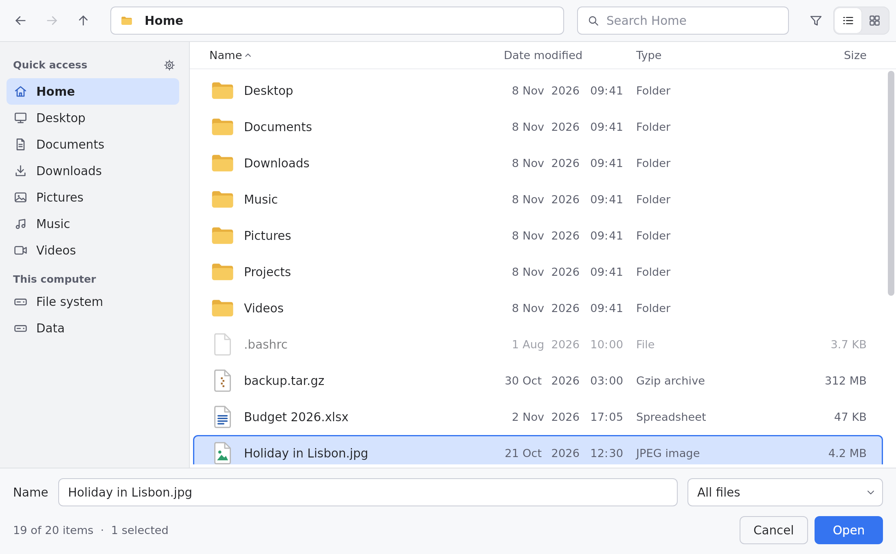

# prism

A file picker for Linux desktops on Wayland, over an index of every file on the machine that the kernel keeps
current. It is meant to stand in for the open and save dialogs applications get through the desktop portal: a
familiar dialog in front, and behind it an index that finds a file by a few typed words, wherever it is, and never
goes stale, because an eBPF program sees every entry the kernel makes, removes or moves. It follows the desktop's
light or dark preference through the portal, over a D-Bus library of its own.

The same browser is also a file manager, `prism explore`, inspired by Explorer and Thunar: it opens files with the
desktop's applications (detached from prism), offers "Open with" and changes the default for a type, shows files'
properties and permissions, and has a preferences window where pinned places, the terminal, and every key and mouse
binding are set. Preferences are one file, watched, so a place pinned in one window is in every picker's and
explorer's sidebar at once.



It is early: the parts exist and are tested, and are not yet joined into the daemon. docs/plan.md says what prism is
for and how it is meant to work; docs/inprogress.md says where it stands.

```bash
./gradlew build
```

```bash
./gradlew :app:run --args="pick"
```

```bash
./gradlew :app:run --args="explore"
```

```bash
./gradlew :app:run --args="scan /usr --runs 5"
```

## Commands

| command | what it does |
|---|---|
| `pick [FOLDER]` | the picker in a window over a folder (your home folder by default), in the desktop's light or dark palette as it changes; prints each path chosen on a line of its own, or nothing and exit status 1 when cancelled; `--save NAME`, `--multiple`, `--folder`, `--theme auto\|light\|dark`; `--decorated` for the window manager's title bar (none by default); `--index [FILE]` searches an index with Ctrl+Shift+F (the usual one, or FILE's), read once and never updated |
| `explore [FOLDER]` | the file explorer, in as many windows as it is asked for, until the last is closed; double-click opens with the desktop's application, Ctrl+W closes a window; `--index [FILE]`, `--theme`, `--decorated` as `pick` takes them |
| `snapshot [FOLDER] --out FILE` | the picker drawn headless into a PNG |
| `daemon [PATH...]` | the index kept current: the watcher started first (or why it could not be), then the index read or built, every change made as it is seen; `--find QUERY` searches once the roots are read, reading places the rules leave out for the search alone; `--in-memory`, `--for N` |
| `index [PATH...]` | folders indexed into the index's file (`/` by default), or the file read where there is one, with what it holds and how long that took; `--find QUERY` searches it, in the search language, with what is wrong with the query underlined and how long each search took; `--fresh` indexes anew |
| `scan [PATH]` | a tree read by each scanner backend, several times, with what each found and how fast |
| `probe c` | the watcher's C, as emitted from its Kotlin declaration |
| `probe check` | every hook of the watcher against the running kernel's own description of its types |
| `probe watch` | the watcher loaded, and the changes it sees printed (needs `CAP_BPF` and `CAP_PERFMON`) |

`prism --help` and `prism COMMAND --help` say more.

## Layout

| module | depends on | what it is |
|---|---|---|
| `cli` | nothing | the command line: typed parameters, a one-pass reader that refuses what it cannot read, help from the same declarations |
| `linux` | nothing | libc through the FFM API: openat, getdents64 read in place, statx, mmap, epoll, each with its errno |
| `ebpf` | nothing | the eBPF DSL: programs in typed Kotlin, emitted as C for clang's BPF target, checked against the kernel's BTF |
| `ebpf-loader` | ebpf, linux | a compiled program loaded and attached through libbpf, its ring buffer read in place |
| `probe` | ebpf | the watcher: hooks on the exits of the VFS functions that change a directory |
| `index` | linux, zstd | the scanner and its backends, the ignore rules, the index as columns and its compressed file, queries (read from text by parser combinators that recover from anything, or built with a Kotlin DSL) and the search that runs them and ranks what it finds, and the usage kept in `$XDG_STATE_HOME`; nothing of eBPF |
| `watcher` | probe, ebpf-loader, linux | the watcher: the probe's program compiled into the module, loaded, attached, and its ring read on a thread of its own |
| `daemon` | index, watcher | the index kept current: a live index that reads places again when told, makes the changes it is told of (again, once a scan they happened during lands), and reads places the rules leave out for searches alone, in memory; and the daemon, which starts the watcher before the index is read |
| `dbus` | kotlinx.serialization, coroutines | D-Bus: the bus's socket, its handshake and `Hello` as a connection opens; messages as data; bodies by kotlinx.serialization, their signatures worked out from the Kotlin types; calls, signals as flows, served methods |
| `portal` | dbus | the desktop portal as prism speaks to it: the appearance settings (the colour scheme, and its changes) |
| `preferences` | kotlinx.serialization, coroutines | what the user has set (pinned places, key bindings, the terminal) as one immutable value, in a JSON file that is watched, so a change reaches every window of every process |
| `desktop` | linux | the desktop as interfaces (file types, applications and defaults, launching, places, a file's facts), and freedesktop.org's implementation: shared-mime-info, desktop entries and their `Exec` lines, `mimeapps.list`, and starting applications detached from prism |
| `browser` | index, desktop, preferences, Compose, coroutines | browsing, as the picker and the explorer both do: an immutable state, a pure reducer from one state to the next, a session that carries out what it asks for, and a view made of controls of its own, worked by the pointer and the keyboard alike; a filter menu of kinds, a gallery with thumbnails, zoom, context menus (menus as data, one component to draw them) that rename, trash, copy, cut, paste and make files and folders, with undo; every key an action the user can bind again; and Ctrl+Shift+F's search of the index, its results shown as a folder holding them all |
| `explorer` | browser | the file explorer: its windows as one immutable list, properties, "Open with", and the preferences window with its bindings page |
| `app` | everything | the command line and the windows |

The modules share their Gradle setup through convention plugins in `build-logic`, as kotlin-engine-test's do
(build-logic/README.md); style is the same house ktlint rules (`./gradlew ktlintCheck`, `./gradlew ktlintFormat`).

## The eBPF DSL

The watcher is written in Kotlin, not C. A program the verifier would refuse is, wherever a type can say so, a
program that does not compile: a value of one width cannot be added to another, a map's value cannot be reached
without the null check the verifier insists on, a ring buffer's reservation cannot be left unsubmitted, a parameter of
one function cannot be read in a hook of another. What a type cannot refuse is reported as data. The C it emits
includes nothing, so building needs only a clang with the BPF target, and every declaration is checked against the
running kernel's BTF before anything is loaded. docs/ebpf.md has the whole of it.

```kotlin
fexit(VfsMkdir) {
    val made = VfsMkdir.returns.value()

    stopIf(made.isErrorOrNull())
    send(changes, onFull = { count(lost, Lost.RingFull) }) {
        it[FsChange.parentIno] = VfsMkdir.dir.value()[Inode.iIno]
        it[FsChange.name] = kernelText(made[Dentry.dName][Qstr.name])
        // ...
    }
}
```

## Setup

The build needs a JDK to run Gradle (the toolchain resolver fetches JDK 25 for the modules), a clang with the BPF
target (the `index` module compiles the watcher), and libbpf at run time to load it. With Nix, `nix develop` (or
direnv) gives all of them; the flake points `PRISM_CLANG` at an unwrapped clang, since the wrapped one adds hardening
flags the BPF target refuses. Without Nix, on Debian or Ubuntu:

```bash
sudo apt-get install clang libbpf1
```

A clang other than the one on the PATH is named with `-Pprism.clang=PATH` or `$PRISM_CLANG`.

## Docs

| doc | what |
|---|---|
| docs/plan.md | what prism is for, how it is put together, and how what is not built yet is meant to work |
| docs/picker.md | the picker: one example followed through, then its state, its rules, its filters, its gallery, its session, its controls and its keys |
| docs/explorer.md | the explorer: a double-click followed from the listing to a detached application, then its windows, the preferences every window shares, properties, "Open with", the bindings window, and what other platforms would need |
| docs/platform.md | what is the same on every platform and what is Linux's; drag and drop followed through every toolkit; what macOS and Windows need, and the command-line picker that is prism's picker there |
| docs/menus.md | a plan for context menus the user configures: actions declared with conditions and commands as words, run detached, in a terminal or watched; the menu's layout; items made as it opens; an editor that shows what an action would do |
| docs/inprogress.md | where the work stands, what is not verified, what is next |
| docs/ebpf.md | the eBPF DSL: what its types refuse, what it reports, what it checks against the kernel, the C it emits |
| docs/scanning.md | how a directory is read, and the measurement that chose getdents64 over the JVM |
| docs/search.md | the search language, by example; how its text is read, however unfinished, into a tree, problems and a query; queries in Kotlin; how a search runs over the index's columns, and how fast |
| docs/daemon.md | keeping the index current: the watcher, what a change becomes, the live index and its scans, places read for searches alone, and why the watcher starting first means nothing is missed |
| docs/format.md | the index's file, byte by byte: a compressed snapshot, then changes appended, compacted by rename |
| docs/dbus.md | D-Bus from the ground up, and how the library maps it onto Kotlin types, calls, flows and served methods |
| docs/testing.md | what the tests need, where they skip, and how to run the watcher on a real machine |
