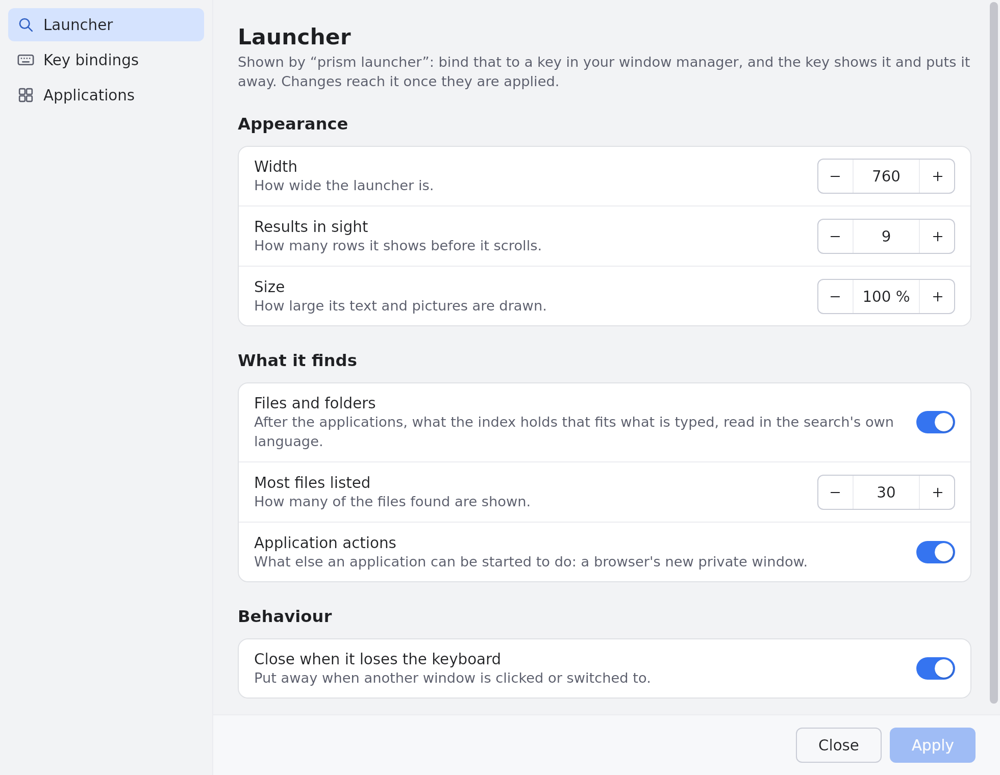
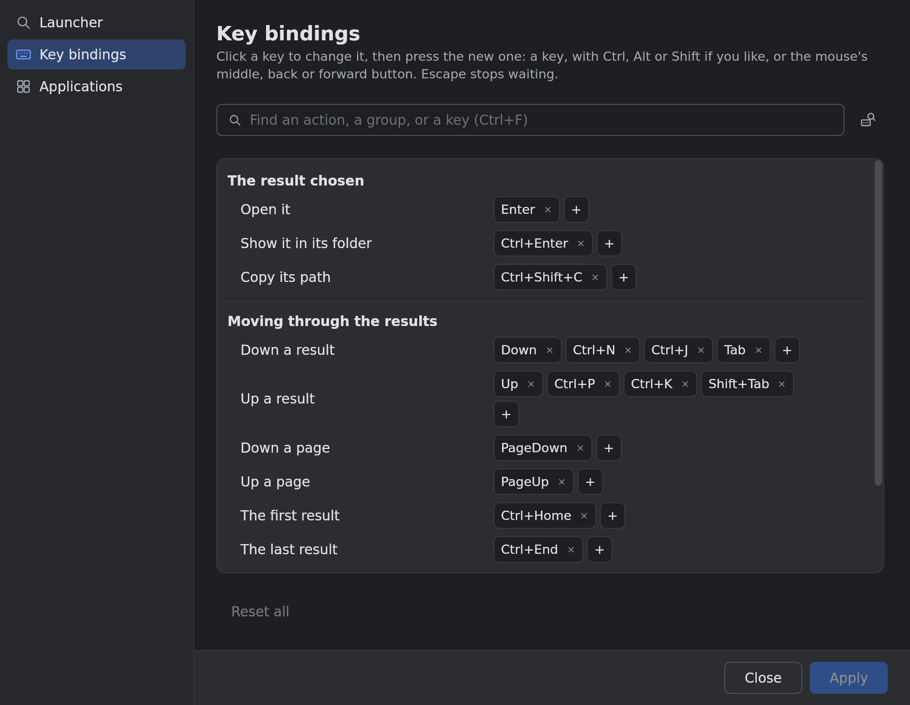

# The launcher

`prism launcher` shows a field in the middle of the screen. Type a few letters, and under the field are the
applications that fit them, then the files that do; Enter starts or opens the one the arrows are on, and the launcher
is gone. It is prism's answer to Vicinae and Raycast, run by the daemon, with the daemon's index to search.


## Using it

Bind `prism launcher` to a key in your window manager (below). Press the key, and:

- **Nothing typed** lists every application installed, the ones you start most and most lately first, then the two
  things prism itself does from here ("Files", a window on your home folder, and "Settings").
- **Typing** narrows the list as you type. `fire` finds Firefox by its name; `browser` finds it by what kind of program
  it says it is; `www` by a word it asks to be found by; `vsc` finds Visual Studio Code by the first letters of its
  words. With several words, every one must be found somewhere.
- **Files** come after the applications, under their own heading: what the index holds that fits what is typed, read
  in the search's own language (docs/search.md), so `report .pdf`, `~/Documents/`, `new:1d` and the rest all work
  here.
- **The arrows** move through the results, the list scrolling to keep the one they are on in sight; Page Up and Page
  Down move a page; Tab and Shift+Tab, Ctrl+N and Ctrl+P, Ctrl+J and Ctrl+K move as Down and Up do.
- **Enter** starts an application, opens a file with whatever opens its kind, and opens a folder in an explorer's
  window. **Ctrl+Enter** shows the result in its folder instead, chosen. **Ctrl+Shift+C** copies its path.
- **Escape** empties the field, and with the field empty puts the launcher away. So does pressing your key again, and
  so does clicking another window.

Along the bottom is what the keys do to the result the arrows are on, and, where something could not be started,
why.


### What is listed, and in what order

The applications are the desktop entries in `applications/` under each of `$XDG_DATA_HOME` and `$XDG_DATA_DIRS`, as
the Desktop Entry specification reads them (docs/explorer.md, "Applications, as they are listed, and their icons"):
an entry with `NoDisplay=true` or `Hidden=true` is left out, so is one whose `OnlyShowIn` does not name your desktop
or whose `NotShowIn` does, and one whose `TryExec` is not installed; an entry in your own folder takes the place of
the system's of the same name, whatever it says. Names and descriptions are in your language where the entry has them.
Each has the icon your icon theme has for it, and the first letter of its name on a tile where the theme has none.

What is typed is words, and each word counts for the best place it is found in:

| found in | counts |
|---|---|
| the application's name | most |
| what kind of program it is ("Web Browser") | less |
| the command that runs it (`code`), and the words it asks to be found by | less again |
| what it says it is for | least |

and within each, the whole of it before its start, its start before the start of a word in it, and that before
somewhere inside. An application you have started from the launcher gains a little for each doubling of its uses, each
use counting half as much every two weeks, so of two that fit equally the one you use comes first; a far better fit
still wins. Among equals, by name.

An application's other actions (a browser's "New Private Window") are listed where a word is in the action's own
name, or where what is typed is the application's whole name; always after the application itself.

What was started is kept in `$XDG_STATE_HOME/prism/launches`, a line an entry. Deleting it forgets the order and
nothing else.

## Settings

"Settings" in the launcher (or Ctrl+comma) opens them in a window of their own, made as the explorer's preferences
are: its pages down the left, the one chosen beside them, and nothing written until Apply (docs/explorer.md, "The
bindings window"). They are kept in `~/.config/prism/preferences.json` under `launcher`, and the launcher is as they
say from then on.



| page | what is on it |
|---|---|
| Launcher | how wide it is, how many results are in sight before it scrolls, and how large it is drawn; whether files and folders are found at all, and how many are listed (30); whether what else an application can be started to do is found; whether clicking another window puts it away |
| Key bindings | every key above, on the page that binds the explorer's: in groups, found by name or by pressing a key, a chord clicked and the next one pressed taking its place, the × taking it away, the + adding one, Reset for the defaults. A chord another of the launcher's actions has is taken from it. A key that types (a letter alone) is refused, since it would never get past the field |
| Applications | each application installed, switched off to leave it out of the launcher (it is still installed, and still opens files) |



The launcher's keys are its own, kept under `launcher.bindings`, each action by its name (`Open`, `Reveal`, `Down`,
...): binding the explorer's keys changes none of them, and binding these none of the explorer's.

## Showing it

`prism launcher` is asked of the prism already running, as `prism explore` is (docs/running.md): a short-lived process
writes the daemon what was asked, the daemon shows the window, and the process ends. So it is on the screen in about
the time a JVM takes to start and say six words (a fifth of a second, from the Nix package), and its results are
there with it: the daemon read what is installed when it last showed the launcher, keeps the pictures it drew, and
has the index in memory. Asked for while it is shown, it is put away, so one key shows and hides it.

With no prism running, `prism launcher` shows the launcher in its own process, with the applications but no index
(`--index [FILE]` gives it one read from a file), and the process ends when the launcher is put away.

The launcher is an ordinary window with no title bar, whose size cannot be changed. A window manager that tiles takes
such a window for a dialog and leaves it floating, in the middle of the screen, at the size it asked for; niri, sway
and Hyprland all do. Its title is "Prism Launcher" (every window of prism's has the app id `prism`), for a rule to know
it by.

### niri

```kdl
binds {
    Mod+Space { spawn "prism" "launcher"; }
}

// Not needed for it to float: only to round its corners and give it a shadow.
window-rule {
    match app-id="^prism$" title="^Prism Launcher$"
    geometry-corner-radius 12
    clip-to-geometry true
    shadow {
        on
    }
}
```

On NixOS with the module (docs/nixos.md), `prism` is on the path and the daemon is the user service `prism.service`,
so the bind is all there is to add.

### Others

- sway: `bindsym $mod+space exec prism launcher`
- Hyprland: `bind = SUPER, space, exec, prism launcher`
- GNOME, KDE: a custom shortcut whose command is `prism launcher`

## How it is made

The launcher is a module of its own (`launcher`), made as the browser is:

- **`LauncherState`** (`model.kt`) is everything: what is typed, what is installed, what was started, what the index
  found, which result the arrows are on. What is shown is worked out from it (`sections`), so nothing shown can be out
  of step with it.
- **`step`** (`step.kt`) is a pure function from a state and an event to the next state and what is to be done: start
  this, search for that, close. It starts nothing itself.
- **`LauncherSession`** (`session.kt`) does what `step` asks, off the thread the window is drawn on, and sends back
  what came of it as an event.
- **`LauncherView`** (`view.kt`) draws a state. The list under the field is the browser's `ResultList`, which the
  search of the index in an explorer or a picker is drawn with too: rows of one height, one of them highlighted, the
  list scrolling to keep it in sight while the keyboard stays in the field.
- **`IconImages`** (`icons.kt`) draws an icon from the file the desktop's icon theme has for it, a PNG or an SVG, at
  the size asked for, once.

The launcher's window is one of the explorer's (`ExplorerWindow.Launching`), so it is opened, closed and, if it ever
fails, reported and replaced by a window that says what happened, as every window is; a launcher that fails takes
nothing else with it.

## Tested

- `LauncherStateTest`: what is found for what is typed and in what order, actions, hidden applications, uses, files
  asked for and stale answers dropped, the arrows' ends, what Enter, Escape, Ctrl+Enter and the copy do, launches kept
  in a file and halved by time, and its keys as the preferences write and read them.
- `LauncherViewTest`: the launcher composed and typed into as a user would, over the tests' desktop and a real index
  of a folder: Enter starts the application, a file is opened with what opens it, a folder in a window, a failure is
  said, forty results scroll under the arrows; an icon drawn from a PNG and from an SVG; and the launcher drawn, in
  both palettes, with whatever this machine has installed and its icon theme's pictures.
- `KeysTest` (explorer): the launcher's settings changed in their window and written only once applied, its keys
  rebound on the explorer's own page, one that types refused, an application switched off; and the pages drawn.
- `ExplorerTest`: the launcher shown, put away by being asked for again, following its settings as they change,
  opening its settings and a folder's window.
- `tools/daemon/check.sh`: `prism launcher` asked of a running daemon shows a window titled "Prism Launcher", and
  asked again puts it away.

## Not yet

- **A layer-shell surface on Wayland.** The launcher is a toplevel window, so it is not above a fullscreen window, and
  where it sits is the window manager's to say. Vicinae uses `wlr-layer-shell`, which SDL does not speak; prism speaks
  Wayland itself for drags, and could for this.
- **A native client.** The process that asks the daemon is a JVM, a fifth of a second to start. A few lines of C that
  write the same request to the socket would make that nothing.
- **Kept warm.** The window is made each time it is shown; kept hidden between, it would be there sooner still.
- **More to find.** A calculator, windows to switch to, the clipboard's history: what Vicinae and Raycast do beyond
  applications and files.
- **Icons for files** from the icon theme; they have prism's own, as a listing's rows do.
