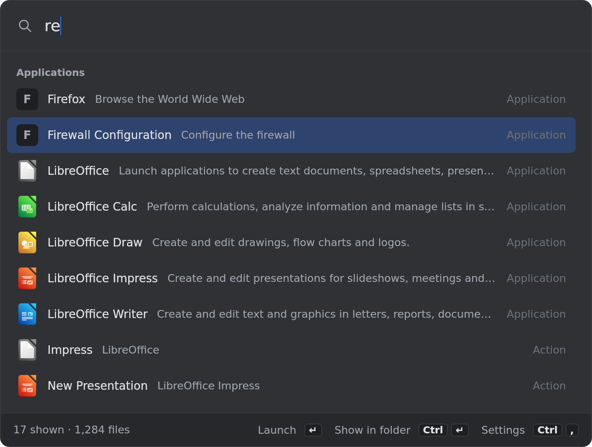
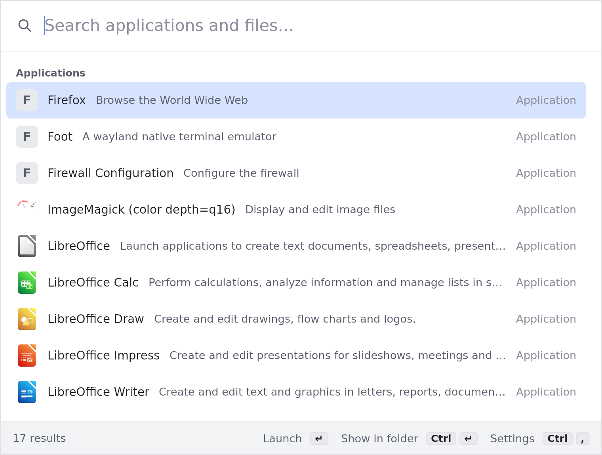
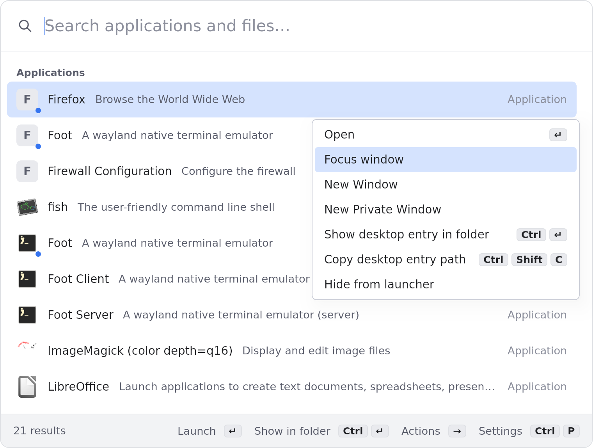
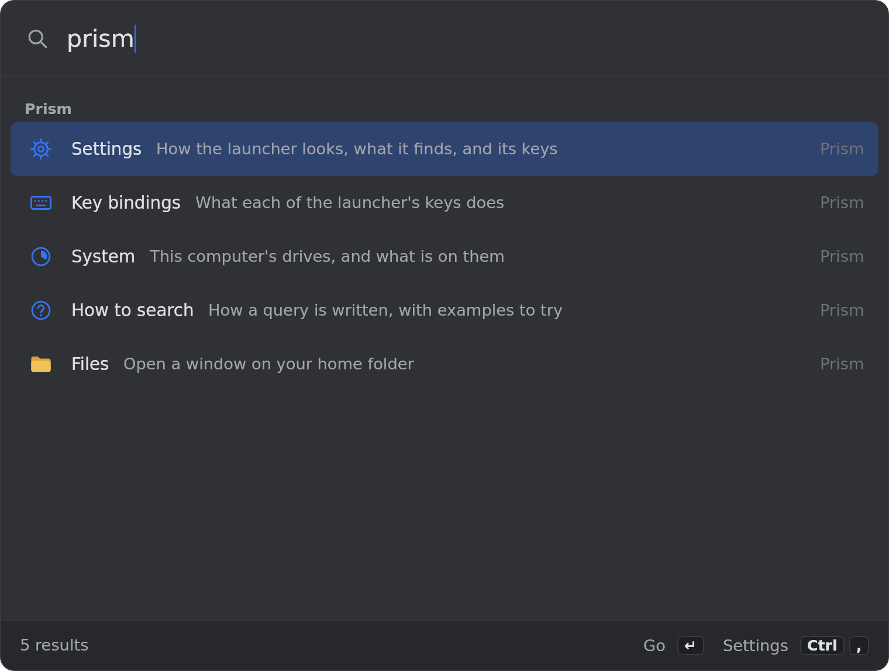
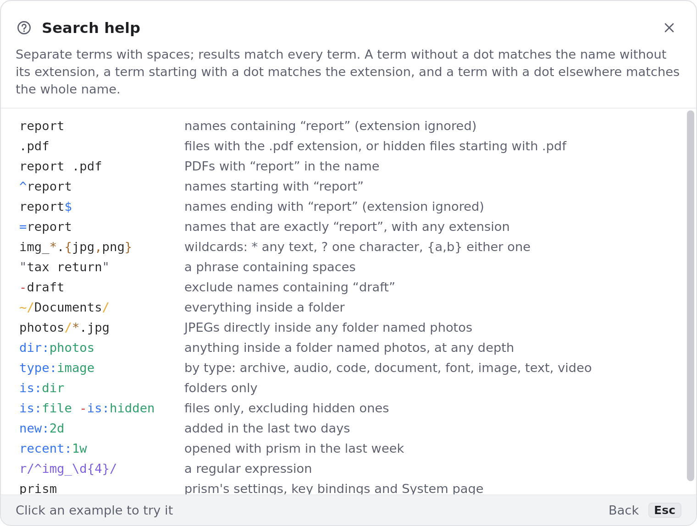
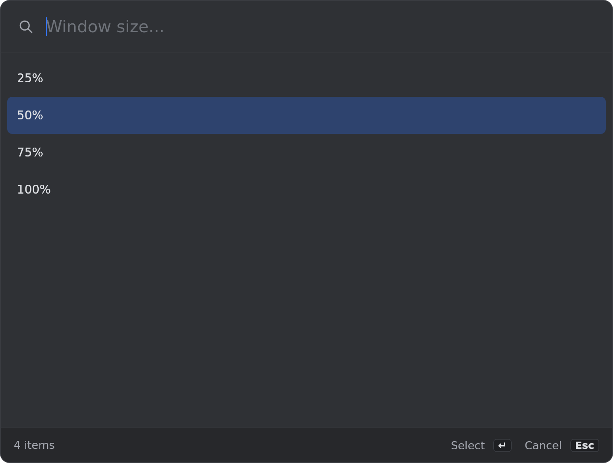
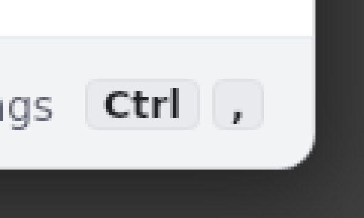

# The launcher

`prism launcher` shows a field in the middle of the screen. Type a few letters, and under the field are the
applications that fit them, then the files that do; Enter starts or opens the one the arrows are on, and the launcher
is gone. It is prism's answer to Vicinae and Raycast, run by the daemon, with the daemon's index to search.



## Using it

Bind `prism launcher` to a key in your window manager (below). Press the key, and:

- **Nothing typed** lists every application installed, the ones you start most and most lately first, then the two
  things prism itself does from here ("Files", a window on your home folder, and "Settings").
- **`prism`**, typed as a word, asks for prism's own things, which come before everything else; and a bare **`?`**
  for how a query is written (below).
- **Typing** narrows the list as you type. `fire` finds Firefox by its name; `browser` finds it by what kind of program
  it says it is; `www` by a word it asks to be found by; `vsc` finds Visual Studio Code by the first letters of its
  words. With several words, every one must be found somewhere.
- **Files** come after the applications, under their own heading: what the index holds that fits what is typed, read
  in the search's own language (docs/search.md), so `report .pdf`, `~/Documents/ report`, `new:1d` and the rest all work
  here; a folder alone (`projects/`) finds the folders of that name, to open.
- **The arrows** move through the results, the list scrolling to keep the one they are on in sight; Page Up and Page
  Down move a page; Tab and Shift+Tab, and Ctrl+J and Ctrl+K, move as Down and Up do.
- **Enter** starts an application, opens a file with whatever opens its kind, and opens a folder in an explorer's
  window. **Ctrl+Enter** shows the result in its folder instead, chosen. **Ctrl+C** copies the file or folder itself, to be
  pasted as one copied in the explorer is (text marked in the field is copied instead, where there is any);
  **Ctrl+Shift+C** copies its path.
- **The right arrow**, once the caret is at the end of what is typed, shows what else can be done to the result the
  arrows are on (below). A right click on a result does the same.
- **Escape** empties the field, and with the field empty puts the launcher away. So does pressing your key again, and
  so does clicking another window.

Along the bottom is what the keys do to the result the arrows are on, and, where something could not be started,
why.



### A result's actions



The right arrow on a result, or a right click on one, opens a menu by its row of what can be done to it. The first
is always what Enter does. Where the launcher has a key that does the same without the menu, the menu shows it.

| the result | its actions |
|---|---|
| an application | Open; Focus window, where it is running (below); each thing its desktop entry says it can be started to do ("New Window"); Show desktop entry in folder; Copy desktop entry path; Hide from launcher |
| a file | Open; Show in folder; Open with…; Copy; Copy path; Copy name; Open terminal here; Properties; Move to trash |
| a folder | the same, without Open with… |
| one of prism's own | Open |

While the menu is open, Up and Down move in it and Enter does the action they are on. The left arrow, Escape, or a
click anywhere else puts the menu away and leaves the launcher as it was, with what was typed still there. Typing
puts it away too.

Most actions put the launcher away once done. Two leave it open and say what happened along the bottom: "Hide from
launcher" (which says where to show the application again) and "Move to trash".

The right arrow only opens the menu when the caret is at the end of what is typed, so it still moves the caret
through the text otherwise. The key is "Show actions" in the launcher's keys, and can be bound to another.

**An application that is running** is marked with a dot at the corner of its icon, and its menu has "Focus
window" right after "Open". "Focus window" brings the window it has open forward and gives it the keyboard; "Open",
and Enter on the row, start the application as they always do. With several windows open there is one action for
each, named by the window's title ("Focus window: Mozilla Firefox").

This needs the compositor to tell prism which windows are open, which it does through
wlr-foreign-toplevel-management. sway, niri, Hyprland and the other compositors built on wlroots or Smithay have it.
GNOME and KDE do not, and on X11 prism does not ask. There, no application is marked and "Focus window" is not
offered; nothing else changes.

A window is an application's when the app id it gives is the desktop entry's name without `.desktop` (`foot`, of
`foot.desktop`), or what the entry says its windows are called (`StartupWMClass`), whatever the case of the letters
(`windowsOf`, `launcher/actions.kt`). The windows are read once, as the launcher is shown.

Listing the windows and bringing one forward is `OpenWindows` (`window/openwindows.kt`): either
`OpenWindows.Unavailable`, or `OpenWindows.Listed` with the windows open now and a way to focus one. On Wayland it
is `Toplevels` (`window/waylandtoplevels.kt`), which speaks the protocol on prism's own connection to the
compositor, as the layer surface does (docs/window.md). The launcher is given it through `LauncherServices.windows`.

The actions are data: `EntryAction`, and `actionsOf(entry)` which lists them for a result
(`launcher/actions.kt`). The menu that is open is `LauncherState.menu`, an `EntryMenu` holding the result it is of
and an `ActionMenu` (`browser/actionmenu.kt`), which always has at least one action and the arrows always on one of
them. The reducer sends the arrows and Enter to the menu while it is open (`inMenu`, `launcher/step.kt`). The view
draws it with `ActionMenuLayer`, which puts it under the row, or over the row where there is no room under, and
never past the window's edge.

### Prism's own, and how to search



What is prism's own is found by its own words, and listed before the applications and the files, which are still
looked for, for the same text, and come after:

| typed | first result | chosen, it |
|---|---|---|
| `settings`, `set`, `preferences` | Settings | opens the launcher's settings, as Ctrl+P does |
| `key bindings`, `keys`, `shortcuts` | Key bindings | opens the launcher's settings at its keys, or turns their window to them where it is open |
| `system`, `drives`, `storage` | System | opens an explorer's window on the System page, pinned to quick access or not |
| `help`, or `?` alone | Search help | shows how a query is written |
| `prism` | all four, and "Files" | |

Each word typed need only begin a word of what it is after, once three letters are typed (`set` is Settings, `se`
is not yet). The word `prism` scopes a search to them: `prism` alone lists them all, and with it a letter is enough
(`prism s`). They are the same items an explorer's search finds (docs/search.md, `Own`); what each does is whoever
lists it's own, so here Settings is the launcher's. With nothing typed, "Settings" and "Files" are listed after the
applications.



How a query is written takes the place of the field and the results, in the same window: a sentence on how a query
is read, and a query a line with what it finds. Clicking one types it into the field and goes back to the results
for it; Escape, or the × in its corner, goes back to the launcher as it was. While it is shown the launcher's other
keys do nothing, since what they act on is not there.

### What is listed, and in what order

The applications are the desktop entries in `applications/` under each of `$XDG_DATA_HOME` and `$XDG_DATA_DIRS`, as
the Desktop Entry specification reads them (docs/explorer.md, "Applications, as they are listed, and their icons"):
an entry with `NoDisplay=true` or `Hidden=true` is left out, so is one whose `OnlyShowIn` does not name your desktop
or whose `NotShowIn` does, and one whose `TryExec` is not installed; an entry in your own folder takes the place of
the system's of the same name, whatever it says. Names and descriptions are in your language where the entry has them.
Each has the icon your icon theme has for it, and the first letter of its name on a tile where the theme has none.

What is typed is words, and each word counts for the best place it is found in:

| found in | counts |
|---|---|
| the application's name | most |
| what kind of program it is ("Web Browser") | less |
| the command that runs it (`code`), and the words it asks to be found by | less again |
| what it says it is for | least |

and within each, the whole of it before its start, its start before the start of a word in it, and that before
somewhere inside. An application you have started from the launcher gains a little for each doubling of its uses, each
use counting half as much every two weeks, so of two that fit equally the one you use comes first; a far better fit
still wins. Among equals, by name.

An application's other actions (a browser's "New Private Window") are listed where a word is in the action's own
name, or where what is typed is the application's whole name; always after the application itself.

What was started is kept in `$XDG_STATE_HOME/prism/launches`, a line an entry. Deleting it forgets the order and
nothing else.

## Modules, and the calculator

Typed into the launcher, `2 + 3 * 4` is answered at once: `14` along the top, over the applications, and Shift+Enter
copies it. Typed, `firefox` is not: nothing is shown along the top, and the applications are as they were. What finds
the answer is a module, and the calculator is the launcher's first.

### What a module is

A module looks at what is typed and says what it makes of it, if anything, and how sure it is that it was meant for
it. The launcher does not decide which module a query is for; each module asked says for itself, and what it says is
shown with everything else. So a module's test of what is meant for it can be simple: one that guesses wrongly costs a
row, and takes nothing away.

What a module makes of what is typed is shown in one of two ways.

- **A banner**, the row along the top: set apart from the results, drawn differently, and never what the arrows are
  on, so that Enter still starts the first application found. It has a key of its own, said on it (Shift+Enter, which
  the keys page of the launcher's settings rebinds as "Use the answer"), and a click on it does the same. What the key
  does is the module's to say: something done (the calculator's answer copied), a menu of what can be done (as the
  right arrow shows a result's), or the module's own view. A banner is shown only where its module is certain.
- **Rows**, among the results, chosen as any result is. A module sure of what is typed has its rows before the
  applications; one that thinks it likely, after them; one that thinks it only possible, after the files.

A module is also a result of its own, found by its name or its prefix as an application is found by its name:
`calc` finds the Calculator, and Tab (or Enter, with the arrows on it) opens its view. A banner says, over its
answer, which module it is of.

Every module also has **prefixes**, which ask for it outright. Typed at the start of the field, a prefix opens the
module's **view**: the module's name is shown in the field, the field is the module's alone (nothing else is looked
for, and what is typed is read however the module reads it), and Escape, or Backspace with nothing typed, leaves it.
A prefix is a word followed by a space (`calc `), or a sign followed by anything (`=`). A word typed in quotes is the
word, and asks for no module: `"calc` searches for "calc". Some modules are reached by their prefixes alone, and are
never asked about what is typed bare.

### The calculator

The calculator is asked about everything typed. It answers along the top where what is typed is arithmetic, which is
where it reads as an expression whole and has an operator in it or calls a function. A number on its own (`42`) or a
name (`pi`, `firefox`) is left to the rest. A date's dashes (`2024-11-18`), or a version's slashes, are arithmetic and
are as likely something else, so what they come to is a row after the files. Its prefixes are `=` and `calc `. In its
view, what is wrong is said as it is typed; the name being typed is completed, with the types each of its overloads
takes and gives (Tab finishes it); and Enter copies the answer.

What is typed is a **Decimal**: exact, of any size, as a person counts. `0.1 + 0.2` is `0.3`, `2 ** 100` is every digit
of it, and `1 / 3` is worked to 34 digits. A Decimal's answer says no type beside it. Each answer says, over it, which module it is of.

For a programmer, any of Kotlin's own number types can be asked for, by converting to it as Kotlin does, or by a
literal's suffix, and from then on the arithmetic is that type's, as Kotlin does it. The type is said beside the
answer, and what Kotlin would hide is said under it:

| typed | answer | said under it |
|---|---|---|
| `5.toUInt() + 1` | `6` UInt | |
| `2147483647.toInt() + 1` | `-2147483648` Int | Overflow: 2147483648 > 2147483647 (Int.MAX_VALUE) |
| `0u - 1u` | `4294967295` UInt | Underflow: -1 < 0 (UInt.MIN_VALUE) |
| `0.1.toDouble() + 0.2` | `0.30000000000000004` Double | |
| `200.toByte()` | `-56` Byte | Overflow: 200 > 127 (Byte.MAX_VALUE) |
| `3.7.toInt()` | `3` Int | 3.7 was rounded toward zero, to 3 |
| `100.toByte() + 100.toByte()` | `-56` Byte | Overflow: 200 > 127 (Byte.MAX_VALUE) |
| `1.toInt() shl 33` | `2` Int | shl by 33 is shl by 1: an Int shifts by the low 5 bits of its count |

There are three ways to ask for a type, and they differ in what they do to a number the type cannot hold:

| written | is | `300` as a Byte |
|---|---|---|
| `5L`, `5u`, `5uL`, `1.5f` | Kotlin's suffixes: a Long, a UInt, a ULong, a Float | |
| `5.int`, `5.uint`, `5.short`, `5.ushort`, `5.long`, `5.ulong`, `5.byte`, `5.ubyte`, `5.float`, `5.double` | a literal of that type, as a suffix makes one | `300.byte` is refused, as `val b: Byte = 300` is in Kotlin |
| `toByte()`, `toShort()`, `toInt()`, `toLong()`, `toUByte()` and the other unsigned, `toFloat()`, `toDouble()`, `toBigInteger()`, `toBigDecimal()` | Kotlin's conversions | `300.toByte()` is `44`, wrapped round, and said so |

When two types meet, the Decimal (what was typed) becomes the other: `5.toUInt() + 1` is a UInt. A floating-point
number wins over a whole one, and a Double over a Float. Two fixed-width integers become the wider of them, and a
Byte with a Byte stays a Byte (where Kotlin would make it an Int), so that a Byte's overflow is seen.
A signed one and an unsigned one are refused, as Kotlin refuses them, since neither holds all of the other. And a value
converted to make two meet must not be changed by it: `5.toUInt() + 1.5` is refused, since 1.5 is no UInt.

The language is Kotlin's arithmetic, with `**` for powers and C's operators of bits beside Kotlin's words for them.
`^` is C's xor, not a power. From the loosest:

| written | is |
|---|---|
| `a shl b`, `shr`, `ushr`, `and`, `or`, `xor` | Kotlin's infix words, grouped from the left: `1 shl 4 + 1` is `1 shl 5` |
| `a \| b` | C's or |
| `a ^ b` | C's xor |
| `a & b` | C's and: `1 \| 4 & 5` is `1 \| (4 & 5)`, as in C |
| `a << b`, `a >> b`, `a >>> b` | C's shifts, and Java's `>>>`, which is Kotlin's ushr: `1 << 4 + 1` is `1 << 5`, as in C |
| `a + b`, `a - b` | |
| `a * b`, `a / b`, `a % b` | a fixed-width integer's division is toward zero, as Kotlin's |
| `-a`, `+a`, `~a` | `~` turns every bit over, as Kotlin's `inv()`: `~0.int` is `-1` |
| `a ** b` | grouped from the right; `-2 ** 2` is `-4`, and `2 ** -1` is `0.5` |
| `a.f(b)`, `a.p` | `f(a, b)`: any function is called after a dot on its first argument; `-1.toInt()` is `-(1.toInt())`, as in Kotlin. A property, such as `5.uint` |
| `1.5`, `0xff`, `0b101`, `0o17`, `1_000`, `1e9`, `(a)`, `pi`, `f(a, b)` | |

The constants are `pi`, `tau`, `e` and `phi`. The functions are declared once each, with typed overloads; completion
shows them as `atan2(y: Double, x: Double): Double`. A call picks the overload that asks least change of its arguments,
and converts them to it as an operand is converted: `sin(1)` takes the Decimal 1 as the Double that `sin` is of, and
`sin(1e400)` is refused, since no Double is that large. There are:

| kind | functions |
|---|---|
| angles, in radians | `sin`, `cos`, `tan`, `asin`, `acos`, `atan`, `atan2(y, x)`, `sinh`, `cosh`, `tanh`, `asinh`, `acosh`, `atanh`, `hypot`, `toDegrees` (`deg`), `toRadians` (`rad`) |
| powers and logarithms | `pow(x, n)` (exact for a whole power), `sqrt` (a Decimal's to 34 digits), `cbrt`, `exp`, `expm1`, `ln`, `ln1p`, `log` (base 10, or `log(x, base)`), `log10`, `log2` |
| of any number, giving its own type | `abs`, `sign`, `floor`, `ceil`, `truncate`, `round` (or `round(x, places)`), `min`, `max`, `coerceIn`, `mod` |
| whole numbers | `factorial`, `gcd`, `lcm`, `inv`, `countOneBits` |
| a Double's own | `ulp`, `nextUp`, `nextDown` |
| forms | `toHex()`, `toBinary()`, `toOctal()` (a fixed-width integer's as its bits are: `(-1).toInt().toHex()` is `0xffffffff`), `toString(radix)`, `grouped()` (`1,234,567.89`), `toFixed(places)`, `toScientific()`, `toPercent()` |

A form is a number shown in a form of its own, and keeps the number and its type: `255.toUByte().toHex()` is `0xff`,
said as "UByte · hex", and `255.toHex() + 1` is `256`.

To add a function, add it to `Library.FUNCTIONS` (calc/library.kt), with its overloads' types; completion and the
choice of overload come of that. To add a module, implement `LauncherModule` (launcher/modules.kt) and put it in
`Modules.STANDARD`: it says how it is reached, what it makes of what is typed bare, and what it shows in its view,
all as plain data. Asynchronous modules, and modules of other programs', are for later; the interface is the same.

## dmenu

`prism dmenu` shows the lines on its standard input in the launcher's window, and prints the one you choose. It is
what dmenu does, and what rofi, fuzzel and Vicinae do in their dmenu modes, so a script written for one of those
works with this:

```sh
echo -e "25%\n50%\n75%\n100%" | prism dmenu --placeholder "Window size..." | xargs -I{} niri msg action set-window-width "{}"
```



- **The lines** are listed in the order they were given; blank ones are left out. Typing narrows them as it narrows
  applications: every word typed must be somewhere in the line, and the best fit is first.
- **The keys** are the launcher's, as you have bound them: the arrows, Page Up and Page Down, Tab, Ctrl+J and
  Ctrl+K move; **Enter** (or a click) chooses; **Escape** empties the field, and with the field empty puts it away.
- **What is printed** is the line chosen, and the status is 0. Put away with nothing chosen (Escape, the launcher's
  own key, a click on another window, another `prism dmenu`), nothing is printed and the status is 1, as dmenu's is.
- **Text that fits no line** is itself the answer: Enter prints what was typed. So with no lines at all it asks a
  question: `prism dmenu -p "Name" < /dev/null`.

Its options are Vicinae's, by the same names, so a `vicinae dmenu` command line works with the program's name
changed:

| option | what it does |
|---|---|
| `-p`, `--placeholder TEXT` | what the field says while it is empty |
| `-q`, `--query TEXT` | what is typed as it opens |
| `-s`, `--section-title TITLE` | a heading over the lines; `{count}` in it is how many are shown |
| `--no-section` | no heading (there is none unless one is asked for) |
| `-n`, `--navigation-title TITLE` | a title, said along the bottom |
| `-f`, `--format data\|index` | print the line (`data`, the default), or where it is among the lines that are not blank, from 0 (`index`; text that fits no line is `-1`) |
| `-W`, `--width PIXELS`, `-H`, `--height PIXELS` | the window's size, where the launcher's own is not wanted |
| `--no-footer` | no line along the bottom |
| `--password` | what is typed is shown as dots |

The window is the launcher's: where it is on the screen, its size, its corners and whether it closes when another
window is given the keyboard are the launcher's settings (below), and a compositor's rule for the launcher is a rule
for this. It takes the launcher's place: the launcher shown is put away for it, and the launcher's key puts it away.

Like `prism launcher`, it is asked of the prism already running, which has the window up at once: the short-lived
process reads the lines, hands them over with its words, waits for the answer however long the choosing takes, and
prints it. With no prism running it shows the window itself, which takes as long as a Java program takes to start.

## Settings

"Settings" in the launcher (or Ctrl+P) opens them in a window of their own, made as the explorer's preferences
are: its pages down the left, the one chosen beside them, and nothing written until Apply (docs/explorer.md, "The
bindings window"). They are kept in `~/.config/prism/preferences.json` under `launcher`, and the launcher is as they
say from then on.


| page | what is on it |
|---|---|
| Launcher | whether its corners are round ("Rounded corners", below; on as it starts), how wide it is, how many results are in sight before it scrolls, and how large it is drawn; whether files and folders are found at all, and how many are listed (30); whether what else an application can be started to do is found; whether it is shown over every window (a layer surface, where the compositor has them), or as a floating window of the window manager's; whether clicking another window puts it away |
| Key bindings | every key above, on the page that binds the explorer's: in groups, found by name or by pressing a key, a chord clicked and the next one pressed taking its place, the × taking it away, the + adding one, Reset for the defaults. A chord another of the launcher's actions has is taken from it. A key that types (a letter alone) is refused, since it would never get past the field |
| Applications | each application installed, switched off to leave it out of the launcher (it is still installed, and still opens files) |
| Aliases | the search aliases (`raws@`), which are every search's and not the launcher's alone: the page the preferences window has, over the same aliases (docs/search.md, "Aliases") |
| Indexing | what the index leaves out and what searches leave out of it, which decides what files the launcher finds: the page the preferences window has, over the same rules (docs/daemon.md) |


The launcher's keys are its own, kept under `launcher.bindings`, each action by its name (`Open`, `Reveal`, `Down`,
...): binding the explorer's keys changes none of them, and binding these none of the explorer's.

## Showing it

`prism launcher` is asked of the prism already running, as `prism explore` is (docs/running.md): a short-lived process
writes the daemon what was asked, the daemon shows the window, and the process ends. In the flake's package that
process is the client, compiled ahead of time (docs/shell.md, "The client"), so the asking takes a few thousandths of
a second, and what is left is the daemon making a window; its results are there with it, since the daemon read what
is installed when it last showed the launcher, keeps the pictures it drew, and has the index in memory. Asked for
while it is shown, it is put away, so one key shows and hides it.

With no prism running, `prism launcher` shows the launcher in its own process, with the applications but no index
(`--index [FILE]` gives it one read from a file), and the process ends when the launcher is put away.

### Over every window

Where the platform has a surface for such things, the launcher is one: over every window, a fullscreen one included,
in the middle of the screen, wherever the window manager would have put a window. On Wayland that is a layer surface
(`wlr-layer-shell`, which niri, sway, Hyprland, KDE and COSMIC have), in the overlay layer, named `prism-launcher`.
It is no window to the compositor: it is in no workspace, has no place in a row of tiles, and is not in a window
switcher.

What it has of the keyboard follows "Close when focus is lost":

| the setting | the keyboard | so |
|---|---|---|
| on (as it starts) | the launcher's as it opens, and whatever is clicked next takes it | a click on another window, or another window opening, puts the launcher away |
| off | the launcher's alone, until it is put away | nothing else can be typed into meanwhile; Escape, your key, or starting something puts it away |

A launcher that holds the keyboard does not see a click beside it at all (it is no bigger than it looks), so it
stays; which is why one that is to close at a click shares the keyboard instead. What a compositor makes of a
surface that shares the keyboard is its own to say, and prism finds its way to the same end on each:

- **niri** gives the launcher the keyboard as it appears, and that is all there is to it.
- **sway** gives a surface that shares the keyboard nothing until it is clicked. So the launcher, not given the
  keyboard a moment after it is on the screen (150 ms), holds it, is given it, and then shares it, which sway lets
  it keep. A key pressed in that moment goes to the window that had the keyboard before; switch the setting off
  there, if that is ever lost to you, and the launcher holds the keyboard from the start.
- A compositor that takes the keyboard back the moment a surface shares it is one the launcher holds the keyboard on
  from then, as if the setting were off: a launcher that cannot be typed into is worse than one that does not close
  at a click.

`PRISM_WINDOW_LOG=1` has the daemon say which of these happened, for each launcher shown.

Where there is no such surface (GNOME's Wayland, X11), or with "Show above all windows" switched off in the preferences
(`launcher.overlay`), the launcher is an ordinary window with no title bar, whose size cannot be changed. A window
manager that tiles takes such a window for a dialog and leaves it floating, in the middle of the screen, at the size
it asked for; niri, sway and Hyprland all do. Its title is "Prism Launcher" (every window of prism's has the app id
`prism`), for a rule to know it by. `PRISM_WINDOW_LOG=1` has the daemon say which it was, as each is opened.

### Round corners

The launcher's corners are round ("Rounded corners", in its settings under Appearance; `launcher.rounded`, on as it
starts): a radius of 12, times the size the launcher is drawn at. prism draws them itself, so they are the same on
every compositor, and nothing of the compositor's has to be configured for them: the window is clear at its corners
(docs/window.md, "A window that is clear"), and what is behind the launcher shows there.



The line round the launcher is prism's too, and follows the corner. It is drawn as the whole shape filled with the
line's colour and the launcher's inside laid over it, one line's width in and clipped to a radius one line's width
less, so the line is as thick round the corner as along the sides, and nothing of the inside (the footer's
background, the field's) shows past it or through its edge.

Round corners need a window that can be clear, and where it cannot be the launcher is square, whatever the setting
says, rather than round with black corners:

| where | the launcher's corners |
|---|---|
| Wayland, as a layer surface or as a window, drawn either way | round |
| X11 with a compositing manager (picom, xcompmgr, KWin, Mutter), drawn by OpenGL | round |
| X11 with a compositing manager, drawn on the CPU | square |
| X11 with nothing compositing the screen | square |
| the setting switched off | square |

Whether its window is clear is decided as the launcher is shown, so the setting switched on is seen the next time
it is shown (switched off, it is square at once).

What a compositor draws round the launcher is drawn round a rectangle unless it is told the shape, so it is worth
telling it. As a layer surface the launcher has no border, focus ring or title bar of the compositor's at all (they
are for windows), on niri, sway or any other; only a shadow, if one is asked for. As a window ("Show above all windows"
off) it has whatever the compositor gives a floating window.

### niri

```kdl
binds {
    Mod+Space { spawn "prism" "launcher"; }
}

// A shadow under the launcher. It is a layer surface, so it is a layer rule that finds it, by its name.
// The radius is the launcher's own, so the shadow is round where the launcher is: without it the shadow
// is a rectangle's, and its square corners show past the launcher's round ones.
layer-rule {
    match namespace="^prism-launcher$"
    geometry-corner-radius 12
    shadow {
        on
    }
}
```

The radius is 12 times the launcher's size in its settings (12 at 100%, 15 at 125%). niri rounds nothing of a layer
surface itself (`geometry-corner-radius` in a layer rule shapes the shadow only), which is why prism draws the
corners. With "Show above all windows" off, the launcher is a window, and a window rule finds it:

```kdl
window-rule {
    match app-id="^prism$" title="^Prism Launcher$"
    geometry-corner-radius 12
    clip-to-geometry true
    shadow {
        on
    }
    // niri's focus ring and border follow the radius above. The launcher has a line of its own, so they
    // can as well be left off it:
    focus-ring {
        off
    }
    border {
        off
    }
}
```

Without `geometry-corner-radius`, niri's focus ring (and its border, if you have one on) is drawn square round the
window, and its corners are seen past the launcher's round ones; with it, the ring follows the launcher's shape.
Both rules are as `niri validate` accepts them (26.04), and both were looked at on it: the shadow round the layer
surface, and the ring round the window.

On NixOS with the module (docs/nixos.md), `prism` is on the path and the daemon is the user service `prism.service`,
so the bind is all there is to add.

### Others

- sway: `bindsym $mod+space exec prism launcher`. sway draws nothing round a layer surface and has no shadows or
  round corners of its own, so there is nothing to tell it. Should it draw a border round the launcher as a window
  ("Show above all windows" off), `for_window [app_id="^prism$" title="^Prism Launcher$"] border none` takes it off.
- Hyprland: `bind = SUPER, space, exec, prism launcher`
- GNOME, KDE: a custom shortcut whose command is `prism launcher`

### On a Mac

A Mac has no window manager to bind a key to a command, so on a Mac the daemon holds the launcher's key itself: press
it anywhere, and the launcher is shown, as `prism launcher` would show it; press it again, or Escape, and it is put
away. The key is ⌘Space, Spotlight's, which Spotlight keeps until its own is turned off: System Settings › Keyboard ›
Keyboard Shortcuts… › Spotlight, and untick "Show Spotlight search". The daemon reads whether Spotlight still has the
key (its symbolic hot key, 64, in `com.apple.symbolichotkeys`) and says so as it starts, with where to turn it off.
Another key is set under `launcher` in `~/Library/Application Support/prism/preferences.json`
(`"hotKey": "Option+Space"`), and taken as the daemon starts again; `prism status` says which it holds.

The key is a Carbon hot key (`RegisterEventHotKey`, macos/launcher.kt), which is how a Mac application has a key of
its own system-wide, and which needs no permission (watching every key, as an event tap does, would need
Accessibility). It is any chord with at least one modifier, written as the bindings are (`Ctrl+Option+K`, `Shift+F1`).

Shown, the launcher is a non-activating panel, as Spotlight's is: it has the keyboard while the application in front
stays in front, its menu bar and all. A window is a panel, and non-activating, by how it is made (the window server is
told then, and not when a style is changed after), so prism makes the panel itself, as AppKit makes one, and gives it
to SDL to be its window, which SDL has a way for (`SDL_PROP_WINDOW_CREATE_COCOA_WINDOW_POINTER`): SDL draws in it and
hears its events, and prism closes it. Two small classes are made for it at run time, each a subclass with methods
alone: a panel that takes the keyboard (one with no title bar refuses it, unasked), and a view that takes the click
that brings the panel forward and passes the right button's press on, as SDL's own view does. It is at the level of a
menu that has popped up, on every Space and beside an application that fills the screen, and not among the windows ⌘`
goes through. Where no panel can be made, the launcher is a window, and the log says so (`PRISM_WINDOW_LOG=1`). The
daemon is in no Dock and no ⌘Tab while the launcher is all it shows.

Its keys are a Mac's: ⌘↩ shows a result in its folder, as Spotlight's does, ⌘⇧C copies its path, and ⌘, opens its
settings. "Focus window" is each application running, brought forward with every window it has: a Mac tells a
program of another's windows only with Screen Recording (their titles) or Accessibility (bringing one forward), which
prism does not ask for.

## How it is made

The launcher is a module of its own (`launcher`), made as the browser is:

- **`LauncherState`** (`model.kt`) is everything: what is typed, what is installed, what was started, what the index
  found, which result the arrows are on, whether how to search is shown. What is shown is worked out from it
  (`sections`), so nothing shown can be out of step with it. Prism's own are `Entry.Prism`, each one of the query
  system's `Own`, found by `Own.found` for what is typed and what the launcher offers.
- **`step`** (`step.kt`) is a pure function from a state and an event to the next state and what is to be done: start
  this, search for that, close. It starts nothing itself.
- **`LauncherSession`** (`session.kt`) does what `step` asks, off the thread the window is drawn on, and sends back
  what came of it as an event.
- **`LauncherView`** (`view.kt`) draws a state. The list under the field is the browser's `ResultList`, which the
  search of the index in an explorer or a picker is drawn with too: rows of one height, one of them highlighted, the
  list scrolling to keep it in sight while the keyboard stays in the field.
- **`IconImages`** (`icons.kt`) draws an icon from the file the desktop's icon theme has for it, a PNG or an SVG, at
  the size asked for, once.

The launcher's window is one of the explorer's (`ExplorerWindow.Launching`), so it is opened, closed and, if it ever
fails, reported and replaced by a window that says what happened, as every window is; a launcher that fails takes
nothing else with it.

A dmenu is the same window with another state behind it (`dmenu.kt`, `dmenuview.kt`): `Dmenu` is what was asked
(the lines, each made ready to be looked through as it is read, and how they are shown), `DmenuState` what is typed
and what was found for it, `step` its reducer, and `DmenuSession` what looks through the lines, off the thread the
window is drawn on, and holds the answer (`DmenuAnswer`: a line chosen, text typed, or put away). Enter pressed
before what is typed has been looked for waits for it, so the line chosen is always one that fits. The field, the
list, the bottom line and the edge are the launcher's own composables. Its window is `ExplorerWindow.Dmenu`, and
`Explorer.dmenu` shows it and waits for its answer.

The command is in two halves. `DmenuCommand` (`client/dmenu.kt`) declares the options, reads standard input and asks
the running prism, with the lines carried in the request (`Caller.input`) and no limit on how long the answer may
take; it is part of the client compiled ahead of time, too, which hands what it read to the Java prism where nobody
answers. `DmenuServed` (`app/dmenu.kt`) is the prism that is asked: it shows the lines and says what is printed.

## Tested

- `LauncherStateTest`: what is found for what is typed and in what order, actions, hidden applications, uses, files
  asked for and stale answers dropped, the arrows' ends, what Enter, Escape, Ctrl+Enter and the copy do, launches kept
  in a file and halved by time, and its keys as the preferences write and read them; prism's own found by the word
  `prism` before everything else and each done where it belongs, and how to search asked for by `?`, shown, left by
  Escape and by its ×, with nothing behind it moved or chosen meanwhile.
- `LauncherActionsTest`: the actions of each kind of result, the first being what Enter does; the menu opened,
  moved in, left by Escape and the left arrow with what was typed still there, and put away by typing; each action
  of an application and of a file done, and what the two that stay say; a window matched to its application by the
  entry's name and by `StartupWMClass`; "Focus window" offered for an application with a window open, one for each
  of several, and not offered where no window is told of; and the key that shows the menu bound to another.
- `LauncherViewTest`: the launcher composed and typed into as a user would, over the tests' desktop and a real index
  of a folder: Enter starts the application, a file is opened with what opens it, a folder in a window, a failure is
  said, forty results scroll under the arrows; prism's own chosen by the keys and by a click; how to search in place
  of the field and the results, the keyboard back in the field when it is left, and a query of its clicked typed
  there; an icon drawn from a PNG and from an SVG; and the launcher drawn, in both palettes, with whatever this
  machine has installed and its icon theme's pictures. A result's menu: the right arrow opens it under the row only
  once the caret is at the end of what is typed, the left arrow and Escape close it and nothing else, a right click
  opens it on the row clicked, and a click in it does the action; an application with a window open is marked and
  its window focused from the menu, and with no windows told of there is no mark and no such action.
- `KeysTest` (explorer): the launcher's settings changed in their window and written only once applied, its keys
  rebound on the explorer's own page, one that types refused, an application switched off; and the pages drawn.
- `ExplorerTest`: the launcher shown, put away by being asked for again, following its settings as they change,
  opening its settings and a folder's window; its settings opened at their keys, their one window turned to them
  where it is open; and a window opened on the System page.
- `DmenuTest`: the lines read from what was piped; every line shown as it opens, what is typed looked for and what
  fitted something typed before dropped; Enter answering the line the arrows are on, waiting where what is typed has
  not been looked for yet, and answering the text where no line fits; Escape, and the window closed; a hundred
  thousand lines looked through by a session; and the whole of it composed and worked with the keyboard and the
  mouse, and drawn in both palettes.
- `DmenuCommandTest` (client), `DmenuServedTest` (app): the options read, short and long; the running prism asked
  with the words said again and what was on standard input; whoever made the command left to show it where nobody
  answers; and what is printed for a line, for its place, for text typed, and for nothing chosen.
- `ExplorerTest`: a dmenu shown and answered by a line, by Escape, by the launcher's key, by another dmenu taking
  its place, and closed where whoever asked is gone.
- `tools/daemon/check.sh`: `prism launcher` asked of a running daemon shows a window titled "Prism Launcher", and
  asked again puts it away.
- `tools/launcher/check-wayland.sh`: the launcher on a real compositor (sway, with no screen; or, with `--here`,
  the session it is run in), looked at by screenshots and typed into as a keyboard would: it is in the overlay layer
  and no window of the compositor's, in the middle of the screen, typed into, Enter starts what was found, the same
  key and Escape put it away, it is drawn over a window that fills the screen, an explorer's window is a window
  still, and with `overlay` off it is a window. Lines are piped to `prism dmenu`: typing narrows them and Enter
  prints the one left, with status 0; Escape, and the launcher's key, print nothing, with status 1. Its corners are read off the screenshots: the pixel at the launcher's
  very corner is what is behind it (the screen's background, and then the terminal that fills the screen), the pixel
  just inside is the launcher's, and with `rounded` off the corner is the line's colour. A terminal is opened whose
  app id is a desktop entry's name, then another window after it; in the launcher the entry is typed for, the right
  arrow, Down and Enter choose "Focus window", and the compositor then says the first terminal is the window in
  front, with the entry's command not run. Run on sway 1.9 and on niri 26.04, each with prism drawing on the CPU and
  with OpenGL.
- `CornersTest`: corners are round only where they are asked for and the window is clear; and the launcher drawn
  with no display, in both palettes at 1x and 2x: its corners clear, the line unbroken along the arc, and every pixel
  that is partly clear the line's colour and nothing else's (no rim of the inside past the line).
- By hand, under Xvfb: with nothing compositing, the launcher is square and its corner the line's colour, not
  black; with xcompmgr, it is round drawn by OpenGL (the corner is xcompmgr's background) and square drawn on the
  CPU.

## Not yet

- **A shadow of its own, and a click outside.** A layer surface is exactly as large as the launcher: a shadow is the
  compositor's to draw (niri's rule, above), and a click beside it is another surface's. Now that its window can be
  clear, the launcher drawn larger than it looks, with what is around it clear, would have a shadow of its own on
  every compositor, and would see the click that should put it away.
- **Round on X11 drawn on the CPU**, and on macOS and Windows: a window there cannot be clear yet (docs/window.md,
  "Not yet"), so the launcher is square.
- **Kept warm.** The window is made each time it is shown; kept hidden between, it would be there sooner still.
- **More modules.** Windows to switch to, the clipboard's history, units and currencies: what Vicinae and Raycast do
  beyond applications and files. And modules that answer later than as what is typed is typed (a web search's
  suggestions), or that are other programs, speaking the same plain data over prism's socket.
- **Icons for files** from the icon theme; they have prism's own, as a listing's rows do.
