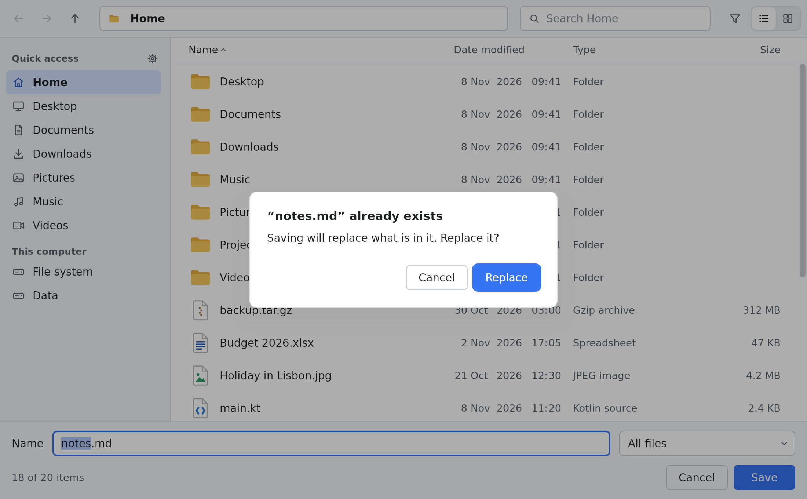
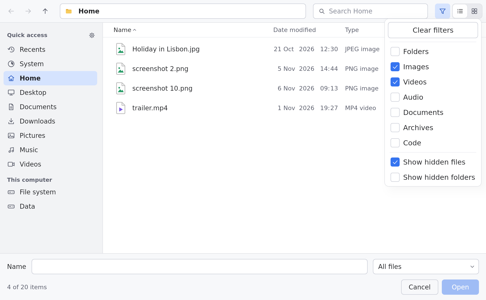
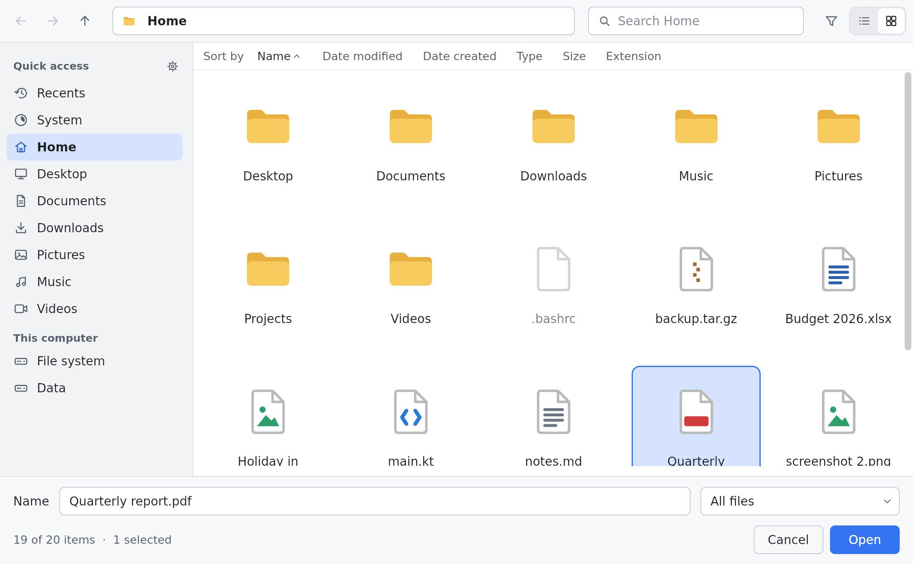
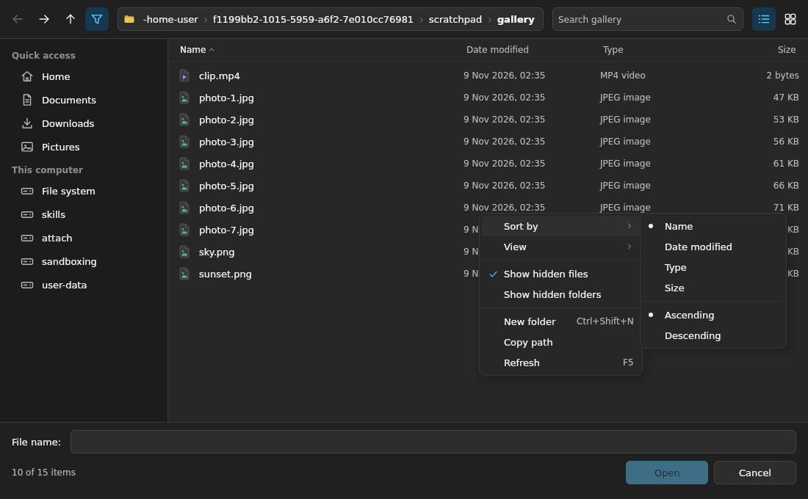

# The picker

The picker is the dialog itself: the window an application's "Open" or "Save as" shows. This page explains how it
works, starting with one example followed from start to finish, and then each part of it in turn.



## One example, followed through

Say the picker opens on your home folder to choose one file, and you press the Down arrow once and then Enter.
Here is everything that happens, in order.

**It opens.** `barion pick` calls `opened`, which makes the picker's first state and says what it needs:

```kotlin
val first: Step = opened(Choosing.OneFile(), folder = home, home = home, sidebar = sidebarOf(home))

first.state.listing   // Listing.Reading(Landing.Top): the folder is not read yet
first.effects         // [Effect.Read(/home/avery)]: please read it
```

A `Step` is a state and a list of **effects**: things the picker wants done that it cannot do itself, because the
code that decides what the picker does never touches the disk. Here it wants the home folder read.

**The folder is read.** A `Session` holds the running picker. It sees `Effect.Read`, reads the folder on a background
thread through a `Disk` (the file system, through the JVM), and sends the answer back in:

```kotlin
Answer.Arrived(folder = /home/avery, read = Listing.Shown(entries))
```

The same function that made the first state now makes the next one from it and this answer. That function is
`step(state, input)`, the **reducer**. It puts the rows in the state, and the window draws them.

**You press Down.** The listing has the keyboard (a picker that opens files starts there), so the view turns the key
into an event and sends it to the session:

```kotlin
PickerEvent.Moved(Move.By(1), Carry.Choose)
```

The reducer moves the cursor to the first row (with no cursor yet, the first move lands on the first row) and
chooses it. The view draws the row highlighted, and the name field shows its name, because the name field shows what
is chosen.

**You press Enter.** That is `PickerEvent.Accepted`. If the row is a folder, accepting goes into it: the reducer
answers with a new state reading that folder, and an `Effect.Read` for it. If it is a file, the reducer answers with
`Effect.Finish(Outcome.Chosen([that file]))`. The session completes its outcome with that, the window closes, and
`barion pick` prints the path.

That is the whole loop: **the view reports what the user did, the reducer decides the next state and what to ask
for, the session carries out what was asked and sends the answers back.** Everything below is a closer look at one
part of it.

## The parts, and where they are

| file | what |
|---|---|
| `model.kt` | the state: `PickerState` and everything it holds |
| `events.kt` | what changes it (`PickerEvent` from the user, `Answer` from the disk) and what it asks for (`Effect`) |
| `step.kt` | the reducer, `step(state, input): Step`, and every rule of what the picker does |
| `session.kt` | `Session`: the reducer run over every input in turn, the effects carried out |
| `source.kt` | `Disk`, and `JvmDisk`: a folder read into rows, a typed path looked up, a change made; the rows' text worked out |
| `trash.kt` | `Trash`: the desktop's own trash, as the freedesktop.org specification lays it out |
| `menu.kt` | `Menu`: menus as data, and `menu { }` to build one |
| `menuview.kt` | `MenuPopup`, `ContextMenus`, `Modifier.contextMenu`, `MenuButton`: any menu drawn and opened |
| `menus.kt` | the picker's own menus: each target's context menu, and the filter menu, from the state |
| `elements.kt` | the controls: a button, a tool button, a text field, a drop-down choice, the keyboard's ring |
| `view.kt` | `FilePicker(state, onEvent)`: the picker drawn from a state, made of those controls |

The reducer is a pure function: it reads nothing and runs nothing. So every rule can be checked as values, by
giving a state and an event and looking at what comes back, and that is what `StepTest` does, forty-odd times.

## What the state holds

`PickerState` is immutable. Each change makes a new one. It holds:

| field | what |
|---|---|
| `choosing` | what the picker is for, and what is chosen so far (below) |
| `folder`, `home` | the folder shown, and the home folder the path across the top starts from |
| `history` | the folders Back and Forward go to |
| `listing` | the folder's entries: being read, read, or unreadable (with why) |
| `arrangement` | the order, the kinds of entry shown, which hidden entries are shown, the application's filter, the search words |
| `layout`, `zooms`, `whole` | the listing as rows or as a gallery; how large each is drawn; and how large a gallery tile can be before it is larger than the gallery, as last measured |
| `landing` | where the cursor goes when the next read of the folder arrives: the folder just left, a file just renamed |
| `renaming` | a row whose name is being typed over, and the name as typed so far |
| `cursor` | the row the keyboard is on, and the row a Shift-range starts from |
| `address` | the path across the top: steps to click, or a path being typed |
| `notice` | a question or a message drawn over the picker ("already exists; replace it?") |
| `waiting` | a typed path being looked up, whose answer is waited for |
| `changes` | the picker's own changes to the disk, each kept as the change that undoes it, and the changes undone |

Some things the view shows are not stored, because they can be worked out from what is: the button's words and
whether it can be pressed (`accept`), what the name field says (`nameField`), the steps of the path (`crumbs`), and
the rows the listing shows (`rows`). Each has one source, so none can disagree with it.

### What is chosen

What the picker is for is a sealed type, and each kind holds only what it can:

| kind | chosen | the button | accepting |
|---|---|---|---|
| `OneFile` | one row or none | Open, once something is chosen or typed | a file is opened; a folder is gone into |
| `Files` | any number of rows | Open, once a file is chosen (or one folder) | the files among them are opened; one folder alone is gone into |
| `SaveAs` | one row or none, and always a name | Save, once the name is not blank; Open while a folder is chosen | saved under the name, asking first if it is a file already; a chosen folder is gone into |
| `Folder` | one folder or none | Select folder, always | the chosen folder, or the folder shown when none is |

So a picker for one file cannot hold two chosen rows: the type has room for one. And a saving picker always has a
name: there is no `SaveAs` without one.

What the types cannot say is checked once, when a state is made: that every chosen row is a row the listing shows,
that the cursor is on one, and that the type filter is one the picker offers. Since every change makes a new state,
no state that breaks those can exist, and so the view is never given one.

### The name field

The name field shows what is chosen ("notes.md", or `"a.txt" "b.txt"` for several) until you type into it. From then
on, what you typed is what the picker accepts, until you choose a row again. That is stored as the `typed` text of the
`Choosing`: null while the field follows the rows, the text once you have typed.

What is typed can be a name, several names in quotes, a path (`Documents/2026`), a path from your home (`~/notes`),
or a path from the root (`/etc/hosts`). Before the picker does anything with it, it is looked up on disk:

```kotlin
step(state with typed = "~/Documents", PickerEvent.Accepted)
// state.waiting = Lookup.Accepting("~/Documents", [/home/avery/Documents])
// effects       = [Effect.Look(that lookup)]
```

and the answer (`Answer.Looked`, each path a `Found.Folder`, a `Found.File`, or `Found.Nothing`) decides: a folder is
gone into, a file is opened, nothing there is "Can't find". Saving, nothing there is the answer wanted (a new file),
as long as the folder it would be in is there; a file there is the question whether to replace it.

The path across the top works the same way: Ctrl+L makes it a field, Enter looks up what was typed, and a folder is
gone to, while a file has its folder gone to and is chosen there.

### Answers that are too late

Reading a folder takes time, and you can go somewhere else meanwhile. So the reducer takes an answer only if the
picker is still waiting for it: a folder's rows only if it is still the folder shown, a lookup only if it is still
`waiting`. Anything else is dropped. That is what makes clicking quickly through folders safe: whatever order the
reads finish in, only the last one counts.

### Going places

Going to a folder puts the folder left on the history's back list and clears the forward list, as a browser does;
Back and Forward move between the two. Going to the folder shown already reads it again (F5 does the same), keeping
what is chosen where it is still there.

When a folder is gone to, the state says where the cursor lands once its rows arrive (`Landing`). Going up lands it on
the folder you came from, so that going down again is Enter.

## What the listing shows: the filters



The funnel button beside the arrows, at the top left, opens the **filter menu**: a list of the kinds of entry, then
"Show hidden files" and "Show hidden folders". The list is a stack of fixed lines with a tick in front of each kind
shown, so turning one on or off moves nothing.

Click "Images", and only the images are shown, and the menu closes: a plain click shows that one kind alone. Open the
menu again and click "Videos" with **Ctrl** held, and the videos are shown as well as the images, and the menu stays
open, so that more can be added the same way (or taken away: Ctrl-clicking a ticked kind unticks it). "All kinds"
shows everything again. The button shows as pressed while any kind is chosen, and the status line says how much is
left out ("2 of 9 items").

A kind is a few of the categories the icons are drawn for, together:

| kind | what it holds |
|---|---|
| Folders | folders, and links to folders |
| Images | PNG, JPEG, GIF, WebP, SVG, AVIF, HEIF, ... |
| Videos | MP4, Matroska, WebM, ... |
| Audio | MP3, FLAC, Ogg, WAV, ... |
| Documents | PDFs, text, Markdown, and office documents, spreadsheets and presentations |
| Archives | zip, tar, gzip, 7z, ... |
| Code | source files of the common languages |

Folders are a kind like any other, so "Images" alone shows images and no folders, which is what a gallery of a
folder's pictures wants. To keep going into folders with a filter on, turn "Folders" on with it. The kinds chosen stay
chosen from folder to folder, so looking through several folders for a picture is one choice, made once. An entry of
no kind (a file of a type the picker does not know, a link to nothing) is shown only while no filter is on.

**Hidden entries** (a name starting with a dot) are apart from the kinds, and come in two: hidden files are shown at
first and hidden folders are not. The folders are kept back because they are where programs keep their own things
(`.config`, `.cache`, `.local`), which are rarely what a person picks from, where a hidden file (a `.env`, a
`.bashrc`) is more often a person's own. Either is turned on or off in the filter menu, or in the listing's own menu,
and they apply whatever kinds are on: with "Folders" chosen and hidden folders shown, `.config` is there. Hidden
entries are drawn dimmed. Ctrl+H shows every hidden entry, or, when every one is shown, none.

The application that asks for a file can also send filters of its own, by name pattern ("PNG images", `*.png`), as
the portal will. Those are the drop-down at the bottom, as in any file dialog, and it is shown only when the
application offers more than one.

## The gallery



The two buttons at the right of the toolbar (or Ctrl+1 and Ctrl+2) show the listing as rows in columns or as a
**gallery** of tiles: each entry's picture, or its icon drawn large, with its name under it. Everything else is the
same: what is chosen, the filters, the double click, the keys. In a gallery, Left and Right move along a line of tiles
and Up and Down move a whole line; the headings that sort become a row of the same choices after "Sort by". The
gallery stays the gallery from folder to folder, until it is switched back.

An image's picture is a **thumbnail** (`Thumbnails`): the file decoded by Skia, the library Compose draws with, scaled
down (never up) to fit 128, 256, 512, 1024 or 2048 pixels, the first at least as large as the tile draws it, and kept, by the
file's path, the time it last changed and that size, so it is made once however often its tile is drawn, and again
once the file changes or the gallery is drawn larger. Decoding a photograph takes tens of milliseconds and the whole
picture's memory while it lasts, so it happens on IO threads, at most four at a time, while the tile shows the icon;
a tile scrolled away before its turn comes is never decoded at all, because asking for it is cancelled with the tile.
What is kept is the pictures used most recently, up to 16 million pixels (64 MB) in all.

The picture above is the real window, on a virtual display, over a folder of generated pictures.

### Larger and smaller

Ctrl and the mouse's wheel draw the listing larger or smaller (Ctrl+= and Ctrl+- too, and Ctrl+0 back to its usual
size): in the list, its rows' type and icons, and in the gallery, its tiles and their pictures. The wheel does this
wherever the pointer is over the picker, and whatever has the keyboard, a search being typed included. A notch of the
wheel is a step, and a touchpad's small scrolls are added up until they make a notch. The list and the gallery each
keep their own size, so a gallery made large to look at pictures leaves the list as it was.

The list goes from three quarters of its usual size to twice it. The gallery goes much further, up to one tile at a
time, as large as the gallery has room for. How far that is depends on the window, so the gallery measures itself as
it is laid out. Take a gallery 770 points wide and 600 high, and a tile, at its usual size, 136 wide and 152 high. A
tile would fill the gallery's width at about 5.7 times that size, and its height at about 3.9 times; it fills the
gallery at the smaller of the two, 3.9 times, and that is as far as the wheel goes. The gallery's steps are those of a
fixed scale (¾, ⅞, 1, 1¼, 1½, 2, 2½, 3, 4, 5, 6, 8 and 10 times) that are smaller than that, here up to 3 times,
and then one last step, **one at a time**, which is exactly as large as the gallery, whatever its size.

The window can change size after a size is chosen. A tile is drawn at the size chosen or at the size that fills the
gallery, whichever is smaller. So making the window so small that a tile no longer fits makes the tiles smaller with
it, one to a line; and making it larger again brings back the size chosen, since what was chosen is kept, and only how
it is drawn changed. One at a time stays one at a time at any size.

## Menus



Right-click a file in the listing, and a menu opens at the pointer:

| | |
|---|---|
| Open | Enter |
| — | |
| Rename | F2 |
| Copy path | Ctrl+Shift+C |
| — | |
| Move to trash | Delete |

Right-click a folder instead, and "Open" goes into it (and a folder picker adds "Select folder"). Right-click one of
several chosen rows, and the menu is of all of them, with nothing that takes only one ("Copy paths", the trash).
Right-click a row that is not chosen, and it is chosen first, alone. Right-click where there is no row, and the menu is
of the folder: "Sort by" and "View" (each opening a submenu beside it), the two hidden checks, "New folder", "Copy
path", "Refresh". Once the picker has changed something on disk, the folder's menu starts with "Undo" and "Redo",
each saying what it will undo or redo: "Undo the rename", "Redo the move to the trash". Shift+F10, or the keyboard's
menu key, opens the same menu at the cursor's row.

"Move to trash" chosen from the menu moves at once: choosing it from a menu is already deliberate. The Delete key asks
first (below, under "Changing what is on disk").

What makes this easy to grow is that **a menu is data**. Here is the file's menu above as the picker writes it
(`menus.kt`):

```kotlin
menu {
    item("Open", PickerEvent.Picked(row.id), keys = "Enter")
    separator()
    item("Rename", PickerEvent.StartedRenaming(row.id), keys = "F2")
    item("Copy path", PickerEvent.CopiedPaths(paths), keys = "Ctrl+Shift+C")
    separator()
    item("Move to trash", PickerEvent.Trashed(ids), keys = "Delete")
}
```

`menu { }` builds an immutable `Menu`: a list of entries, each an **item** (a label, the action it gives, whether it
can be chosen, a tick or a dot, its keys), a **submenu** (a label and a menu), or a
**separator**. The builder keeps separators only between groups, so a group left out for one target (no "Rename" for
several rows) leaves no stray line, and a submenu with nothing in it is left out.

Each item's action is the event choosing it reports, exactly as if the user had pressed its keys: "Rename" reports
`StartedRenaming`, the same event F2 reports. So choosing from a menu is just another way to do what the picker can
already do, and the reducer decides what comes of it. The menu knows nothing of what its actions mean: a `Menu<A>` is
generic in its action, and the picker's menus are `Menu<PickerEvent>`.

Which menu opens is a pure function of the state and what was pressed, a `Target`:

```kotlin
fun contextMenuOf(state: PickerState, target: Target): Menu<PickerEvent>
```

where a target is some rows, or the folder itself. That is where menus vary by what they are of: a file or a folder,
one row or several, what kind of picker it is. A new kind of target (a place in the sidebar, a step of the path) is a
new case of `Target`, and a new kind of entry with an item of its own is a new branch where its rows' menu is made.
Since the function is pure, what every menu offers is a test of values (`MenuTest`).

One component draws any menu (`menuview.kt`): `MenuPopup` opens it at a point of the window (for a context menu), below
a button, or beside its entry (for a submenu), turned to fit where there is no room. The pointer lights an entry and
opens a submenu by hovering, and chooses by clicking; the keyboard, which a menu takes while it is open, lights entries
with Up and Down, opens and leaves submenus with Right and Left, chooses with Enter, and closes with Escape. Choosing an
item closes the whole menu, except that an item can have an **alternate**: what it does when chosen with Ctrl, leaving
the menu open. That is how the filter menu's Ctrl-click adds a kind.

Context menus are put on anything with `Modifier.contextMenu(menus) { ... }`, which gives the menu to open as the right
button is pressed there; one `ContextMenuHost` per part of the view draws the menu open, so one is open at a time, and
something inside (a row) takes its own press before what holds it (the listing) does. `MenuButton` is a toolbar button
with its menu under it, as the filter menu is.

## Changing what is on disk

A picker is where people find a file is misnamed, or that a folder is needed, so it can change things a little, as
the desktop's own dialogs can:

- **Rename** (F2, or the menu): the row's name becomes a field with the name's stem selected, so typing replaces the
  name but not its extension. Enter, or clicking away, gives the new name; Escape leaves it as it was. A name with a
  slash in it, or `.` or `..`, is refused before the disk is asked. The disk never renames onto something already
  there.
- **Move to trash** (Delete, Shift+Delete, or the menu): into the desktop's own trash, as the freedesktop.org trash
  specification lays it out (`~/.local/share/Trash`: the entry in `files`, and an `info` file saying where it was and
  when), so the desktop's file manager can put it back. Delete alone asks first ("Move “notes.md” to the trash?"),
  since a key is easier to press by mistake than a menu item is to choose; Shift+Delete and the menu do not ask. An
  entry on another drive than the trash is refused, with why, since a trash only takes what can be moved into it
  without copying.
- **New folder** (Ctrl+Shift+N): "New folder", or "New folder 2" where that is taken, its name then typed over.

Nothing is ever deleted for good: the picker has no way to. Whatever it removes goes to the trash, from which Ctrl+Z,
or the desktop's file manager, can put it back.

Each is an effect the disk carries out (`Change`), and whatever came of it, the folder is read again, since a change
half done is a change; what failed is said, with why. The cursor lands on what the change made: the renamed entry,
chosen, or the new folder, its name being typed.

### Undo and redo

Ctrl+Z undoes the picker's latest change to the disk, and Ctrl+Shift+Z (or Ctrl+Y) does it again; the folder's menu
offers the same. Undoing goes back through every change made since the picker opened, the latest first, and a new
change, once something has been undone, leaves nothing to redo, as in an editor. In a text field, Ctrl+Z undoes the
field's own typing instead, as it does anywhere.

What makes this simple is that the disk, as it makes a change, answers with the change that undoes it:

| the change | the disk's answer: what undoes it |
|---|---|
| rename `notes.md` to `journal.md` | rename `journal.md` to `notes.md` |
| make the folder `New folder` | remove the folder `New folder` |
| move `notes.md` to the trash | put back `notes.md`, which the trash keeps as `notes.md.2` |

The last row is why the answer comes from the disk rather than being worked out beforehand: the name the trash keeps
an entry under (`notes.md.2`, since a `notes.md` was already there) is only known once the entry is in it.

The picker keeps these answers in a list, `changes.undo`. Ctrl+Z takes the latest from that list and asks the disk to
make it, as it would any change, and the disk answers in turn with what undoes *that*: undoing the rename above
answers "rename `notes.md` to `journal.md`", which goes on a second list, `changes.redo`, for Ctrl+Shift+Z. So an undo
and a redo are each just a change, made the same way as the first, and only the two lists know which is which.

An undo never loses anything. A folder is removed only if it is still empty, and an entry is put back from the trash
only if nothing of its name has appeared where it was meanwhile. Otherwise the undo fails, says why ("Couldn't undo
the new folder: “New folder” isn't empty any more"), and leaves the disk as it is.

## The mouse's side buttons

Most mice have two buttons at the side, back and forward. They go back and forward in the picker as in a browser,
wherever the pointer is over it.

Compose cannot be asked for them on Linux, because the numbers for mouse buttons differ along the way:

| the button | X numbers it | the JDK passes it on as AWT's | Compose reports |
|---|---|---|---|
| left, middle, right | 1, 2, 3 | 1, 2, 3 | primary, tertiary, secondary |
| scroll up and down | 4, 5 | the wheel | a scroll |
| scroll left and right (a tilted wheel, a touchpad) | 6, 7 | 4, 5 | **back, forward** |
| back, forward | 8, 9 | 6, 7 | nothing |

Compose takes AWT's 4 and 5 for back and forward, which is right on Windows. On Linux it reports a sideways scroll as
back and forward, and the side buttons as nothing at all. So the picker reads the side buttons from AWT itself, by
Linux's numbering (`SideButtons`, which the app puts in its window), and does nothing with what Compose calls back and
forward. Both halves were checked on a real window: X's buttons 8 and 9 go back and forward, and 6 and 7 do nothing.

## The listing's rows, and keeping them fast

A folder is read once into its **entries**: every one, hidden files included, in no particular order. What the
listing shows is the entries arranged: sorted, then narrowed by the filter, the search words and whether hidden files
are shown. That is `rows`.

Working that out on every key press would be slow for a large folder: moving the cursor through a folder of a hundred
thousand entries would sort it again each time. So the listing keeps what it last worked out: the entries sorted by
the last order asked for, and those narrowed by the last arrangement asked for. Moving the cursor asks for the same
arrangement and gets the same rows back at once; typing a search word narrows the sorted rows again but does not sort
them; clicking a column's header sorts once. The rows also keep where each row is, so finding the cursor's row is a
lookup, not a search. (This is the one place a value changes inside something immutable, and nothing outside can see
it change.)

Names are compared as people read them: without case, and with numbers by value, so `file2` comes before `file10`.
That comparison is made n log n times for every sort, so it walks both names in place rather than splitting them up.

## The session

`Session` is the picker running. It folds the reducer over every input in the order they arrive, starting from the
first step:

```kotlin
inputs.runningFold(first) { last, input -> step(last.state, input) }
```

and for each step, carries out its effects: a read or a lookup runs on a background thread, and its answer joins the
inputs; a finish completes `outcome`. The current state is a `StateFlow` the window collects. A disk that fails
outright (an exception rather than an error it reports) is answered as unreadable or not found, so a failure never
stops the picker.

`Disk` is an interface, so what reads folders can change without anything else changing. Today it is `JvmDisk`. When
the index is behind the picker, it will be another `Disk`.

## The view and its controls

`FilePicker(state, onEvent)` draws a state and reports events. It changes nothing itself.

It is made of the controls in `elements.kt`. Each draws its own looks (hovered, pressed, focused, disabled) from the
palette, takes the keys a desktop's controls take, and reports only what it is for:

| control | what it is | keys |
|---|---|---|
| `PickerButton` | a button with words: Open, Cancel, Replace, Move to trash | Enter, Space |
| `ToolButton` | a button with a glyph: Back, Forward, Up, the list and the gallery (one of a set shown as selected) | none: they have shortcuts of their own, so Tab passes over them |
| `MenuButton` | a tool button with a menu under it: the filters | |
| `Field` | a line of text: the path, the search, the name, a name being renamed | as any text field; it selects all its text when the keyboard arrives (saving and renaming, the name without its extension, so typing replaces only the name) |
| `Select` | a choice from a list: the application's filter | Enter, Space or Alt+Down open it; the arrows choose without opening it |
| `MenuPopup` | a menu, anywhere | as above, under Menus |
| `ring` | the ring around what the keyboard is on | |

A control keeps only what a control keeps on any desktop: whether the pointer is over it, whether its menu is open,
where the caret is in its text. The view adds four things of the same kind: which place the sidebar's arrows are on,
the letters typed in quick succession in the listing, the last row pressed (for a double click), and the context menu
open.

### Where the keyboard is

The ring that shows where the keyboard is, is drawn only when the keyboard was used last, as a browser draws its
focus ring (`:focus-visible`). The picker notes which was used last as each key or button goes down
(`KeyboardUse`). So a control clicked with the pointer keeps the keyboard, ready for it, but shows no ring once the
pointer has gone on to something else; press a key, and the ring is back where the keyboard is. A text field shows
that it is being typed in whichever was used, since that is where typing goes.

### Double clicks

A row is chosen the moment it is pressed, not after waiting to see whether a second press follows. Whether two presses
are a double click is decided by the listing, not by the row, because only the listing sees every press: a double
click is two plain presses of the same row, soon enough, with nothing between. So clicking a row, Ctrl-clicking
another, and Shift-clicking the first again chooses a run of rows; it does not open the first.

### The keyboard

Tab goes through the picker in this order: the path, the search, the places, the listing, the name, the
application's filters (where it offers a choice), then the buttons. The places and the listing are one stop each,
inside which the arrows move; clicking a place or a row takes the keyboard there too. When the picker opens, the
keyboard is on the listing, or on the name for a picker that saves.

| keys | where | what |
|---|---|---|
| arrows, Page Up and Down, Home, End | listing | the cursor; with Shift, choosing a run; with Ctrl, not choosing (in a gallery, Left and Right along a line, Up and Down a line at a time) |
| Space | listing | the row at the cursor chosen, or no longer |
| Enter | listing, name | accept (a chosen folder is gone into) |
| letters | listing | the next row whose name starts with them; the same letter again, the next such row |
| Backspace | listing | the folder above |
| Ctrl+A | listing | every row chosen |
| F2 | listing | rename the row chosen |
| Delete | listing | the rows chosen to the trash, asking first |
| Shift+Delete | listing | the rows chosen to the trash, without asking |
| Ctrl+Shift+C | listing | the paths of the rows chosen (or of the folder) copied |
| Shift+F10, the menu key | listing | the menu of the rows chosen, or of the folder |
| Alt+Left, Alt+Right, Alt+Up | anywhere | back, forward, up |
| Ctrl+L, Alt+D | anywhere | type a path |
| Ctrl+F, F3 | anywhere | search |
| Ctrl+H | anywhere | every hidden entry shown, or none |
| Ctrl+Shift+N | anywhere | a new folder |
| Ctrl+1, Ctrl+2 | anywhere | the list, the gallery |
| Ctrl+=, Ctrl+-, Ctrl+0, Ctrl and the wheel | anywhere | larger, smaller, the usual size |
| Ctrl+Z; Ctrl+Shift+Z, Ctrl+Y | anywhere but a text field | the picker's latest change to the disk undone; done again |
| the mouse's side buttons | anywhere | back, forward |
| F5, Ctrl+R | anywhere | the folder read again |
| Escape | anywhere | cancel; in the path or a search with words in it, first leave that |

The keys with Ctrl work while a field is being typed in, as well. That takes one more step than it seems to, because a
key pressed with Ctrl reaches the window twice: once as the key going down, and once as the character it types, so
Ctrl+2 also types a "2". The picker acts on the first and drops the second, so the search does not fill with "2"s. It
drops only a character typed with Ctrl alone, not with Ctrl and Alt, which is AltGr on many keyboards, the way "@" and
"€" are typed.

The listing keeps the cursor's row in sight, scrolling as little as it takes: a row just past the bottom scrolls the
list by one row, not a page, and a row far away is scrolled to directly (never by laying out every row between).

## How it is tested

- **The rules** (`StepTest`): states and events in, states and effects out, with folders read from a small file
  system held in memory. Every rule above has a test there, the filters' among them.
- **The thumbnails** (`ThumbnailTest`): real image files scaled to fit and not up, kept, made again once changed or
  drawn larger, and nothing made of what is not an image.
- **The menus** (`MenuTest`): what each target's menu offers, what each item does and shows as on, and the builder's
  separators.
- **The disk** (`DiskTest`): renaming never onto something there, and undone by renaming back; a folder made only
  where there is nothing, and removed only while empty; the trash as the desktop's own (its `files` and `info`, a
  second of a name kept beside the first, paths written as a URL's); what is trashed put back where it was, never over
  something there now; and a name the trash holds without its record passed over.
- **The picker as a user meets it** (`InteractionTest`): composed headless around a running `Session` over a real
  temporary folder, then clicked, double-clicked, Ctrl- and Shift-clicked, typed at and tabbed through with
  Compose's own test input, and what it shows and how it ends checked: the filter menu by pointer, by Ctrl-click and
  by keyboard; a row's menu renaming it on disk; F2 and Escape; the trash, asked about by Delete and not by
  Shift+Delete or the menu, and Ctrl+Z and Ctrl+Shift+Z putting back and trashing again; the folder's menu sorting
  through a submenu and making a folder, then the rename and the folder undone and redone, by the menu and by keys;
  Shift+F10; Ctrl and the wheel, over the listing and over the places while a search is typed; Ctrl+1, Ctrl+2 and
  Ctrl+= in the search, typing nothing into it; the gallery with a real picture, its keys and its double click; and the
  gallery zoomed to one tile at a time, and drawn smaller as the window is made narrower and larger again as it is
  widened. Compose's test keyboard sends a key going down and up, but not the character a real keyboard types between
  the two, so the search's test sends that character itself, as an AWT event; without it the test would pass even
  with the search filling with "2"s. These are what found that a Shift-click was being read as a double click, and that the
  listing scrolled before it had been laid out.
- **The drawing** (`PickerTest`): every kind of picker drawn headless, in both palettes, with a notice up, a path
  being typed, a search and an unreadable folder; `-Ppicker.screenshots=DIR` keeps the pictures.

`barion pick` itself has been run in a real window on a virtual X display (Xvfb), driven by xdotool: opening a file
from the keyboard, several with Ctrl-click and the Open button, saving under a typed name, choosing a folder, and
cancelling with Escape, each printing what it should; the gallery over real pictures; the mouse's side buttons,
which only a real window can test, since they come from AWT; and, in the dark palette, no ring left on a control once
the pointer has moved on, the filter menu with Ctrl-click, the folder's menu with a submenu turned to fit, sorting from
it, renaming from a row's menu, Ctrl and the real wheel in the list and the gallery, and a click outside a submenu
closing the whole menu. And since: Ctrl+2 typed in the search with real X key events, the search keeping what was
typed; Ctrl and the wheel over the sidebar; the gallery turned all the way in, one picture at a time, then the window
made smaller (the picture shrinking to fit) and larger again (the size chosen coming back); and Delete's question,
Enter, Ctrl+Z, Ctrl+Shift+Z and Shift+Delete on real files, with the trash in a temporary folder. docs/testing.md
says how to do the same.

## Not yet

- The portal: each request of an application becoming a picker (docs/plan.md, "The portal").
- Reading folders from the index, and the search language searching all of it rather than the folder shown.
- Filters by MIME type, as the portal can send them; today the application's filter is name patterns (`*.png`), and
  the kinds go by extension.
- Pictures of videos and documents (ffmpeg, poppler), and the pictures the desktop has already made
  (`~/.cache/thumbnails`), before making its own.
- A preview pane, column widths kept, drag and drop out of the picker, and a menu on a row (a new folder, rename).
