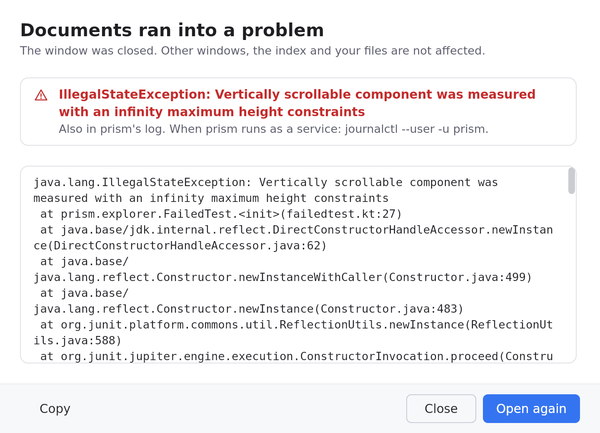

# Running prism: the daemon, one prism for the session, and what happens when something goes wrong

prism is meant to be running all the time you are logged in: one process, the **daemon**, which keeps the index
current and opens every prism window. This document says how that process is run, how a `prism` typed in a terminal
or started from a launcher finds it, what happens when it is not there, and what happens when something in it fails.
docs/nixos.md says how NixOS sets all of it up; docs/daemon.md says how the index itself is kept.

## An example, first

Say you are logged in, the daemon was started with your session, and you press the key your launcher binds to prism.

1. The launcher runs `prism`. That is a new process, and a small one (in the flake's package, a program compiled
   ahead of time that does nothing but this: docs/shell.md, "The client"): it takes its words (none, which means
   `prism explore`, on your home folder), and looks for a socket at `$XDG_RUNTIME_DIR/prism/prism.sock`.
2. The daemon is listening there. The new process writes it what it was asked: the words `explore`, the folder it
   was started in, and the token the launcher gave it for the window to be given the keyboard. Then it waits.
3. The daemon reads the words exactly as it would read its own command line, and opens an explorer window on your
   home folder, beside whatever windows it already has. It answers: done, nothing printed, status 0.
4. The new process prints what it was answered (nothing), exits with the status it was answered (0), and is gone.

The window is the daemon's. It searches the daemon's index, as it is at that moment. The process the launcher started
lived for a few thousandths of a second and never loaded a window toolkit, which is the point: starting a Java
program that opens windows takes a second or two, and asking one that is already running takes next to nothing (the
numbers are below).

Now say something goes wrong in that window: a mistake in prism's drawing code throws while the window is being
laid out. The window is closed. A small window opens in its place, which says what was closed, what went wrong in a
line, and where, in full, with buttons to copy that and to open the folder again. The same text is written to the
daemon's standard error, which under systemd is the journal. Every other window is as it was, and so is the index.



The rest of this document is each of those parts in turn.

## The commands

| command | what it is |
|---|---|
| `prism`, `prism FOLDER`, `prism explore FOLDER...` | an explorer window on a folder (your home, with none named), or on a file's folder with the file chosen; opened by the prism already running where there is one |
| `prism launcher` | the launcher: applications, then files, found as you type (docs/launcher.md); shown by the prism already running where there is one, and put away where it is shown already, so one key bound to it shows and hides it |
| `prism dmenu` | the lines on standard input, in the launcher's window to choose one of, and the one chosen printed, as dmenu does (docs/launcher.md, "dmenu"); shown by the prism already running where there is one |
| `prism --isolated`, `prism explore --isolated` | the same, in a process of its own, whether or not a prism is running: it asks nobody, and nobody asks it |
| `prism daemon` | the daemon, started apart from the terminal; returns once it has said it started |
| `prism daemon --foreground` | the daemon, run in place, saying what it does on the terminal until stopped: how systemd runs it, and how to watch it |
| `prism status` | what the prism already running says of itself; status 1 where none is |
| `prism search QUERY...` | the paths the index holds that fit a query, best first, printed; `-s` exactly one, `-i` chosen from a menu (docs/shell.md, which has a shell's function that goes to what is found); answered by the prism already running, of its live index, or from the index's file where none is |

`prism --help` lists the rest. A word after `prism` that names no command is `prism explore`'s, so `prism ~/Documents`
is `prism explore ~/Documents`; a folder whose name is a command's is written with a path (`prism ./index`).

## One prism for the session's windows

**Who listens.** Any prism that opens explorer windows listens, not only the daemon. The place is
`$XDG_RUNTIME_DIR/prism/`: a socket (`prism.sock`) and, beside it, a lock file (`prism.lock`). The runtime folder is
where a session's sockets are kept (Wayland's own is there), it is yours alone, and it is gone at logout. Whoever
holds the lock is the session's prism. The lock is the kernel's, so it is let go when its process ends, however it
ends: a socket file left behind by a prism that was killed is known to be nobody's, and the next prism takes the
place. Where `XDG_RUNTIME_DIR` is not set there is no place, and every prism is on its own.

**What is asked.** A command line: its words, the folder they were said in, and two variables of the asker's
environment (`XDG_ACTIVATION_TOKEN` and `DESKTOP_STARTUP_ID`, with which a desktop lets a new window take the
keyboard). The folder matters: `prism docs` typed in `~/work` means `~/work/docs`, and the daemon's own folder is
somewhere else, so a path that does not start at the root is read from where it was said. Nothing else of the asker's
environment is used: a window opened by the daemon is the daemon's, and what it starts is started with the session's
environment, as with any file manager that runs this way.

**What is answered.** One of two things. Either the words were run, and here is what they printed and their exit
status, which the asker prints and exits with (so `prism nosuchfolder` says `prism explore: nosuchfolder does not
exist` and exits 1, whoever ran it). Or they could not be run here, and why, and the asker runs them itself. The
second answer is what makes the arrangement safe to rely on: whatever the running prism cannot do for another (it has
no display, its windows have failed, it is another version and reads the words differently), the cost is only the
start the asker would have paid anyway. A prism that listens but does not answer within twenty seconds is treated as
not there.

**Which commands are asked.** `explore`, `launcher`, `status`, and `matches`, which is what `prism search` asks for
what the index holds (docs/shell.md). Every other command runs in the process that was started. `prism explore` or
`prism launcher` given anything that says how its windows should be (`--theme`, `--decorated`, `--index`) is one of
those too: a running prism's windows are as it was started, so asking it would ignore what you said. It opens in a
process of its own, as `--isolated` does.

**Who decides.** The prism that is asked. The client sends a command line's words as they were typed, without reading
them; the prism running reads them as its own, and a command it does for others says which of its invocations ask
for a process of their own (`Served.apart`). Those it refuses, as it refuses a command it does not do for others, and
whoever asked does them itself.

**Without a daemon.** The first `prism` finds nobody listening. It takes the place, opens its own window, and is the
session's prism for as long as it has a window open: a second `prism` hands it its words, and its window opens in the
first. When the last window is closed, the process ends, and the place is free. Only the daemon stays with no window
open. Two started at the same moment end as one that listens and one that asked it: taking the place and asking are
tried in turn for a few seconds, since between a prism taking the lock and its listening there is a moment when it is
neither.

**A daemon started while another prism has the place** (you ran `prism` before the service came up) keeps its index
and waits. When that prism's last window is closed, the daemon takes the place, and says so.

**`--isolated`** takes no place and asks nobody: a process with its own windows, which ends when they are closed.
It is for looking at one prism without another being involved.

### How long it takes

Measured in the development container, on a virtual display, from the command being run to its returning, which is
when the daemon has opened the window:

| | time |
|---|---|
| `prism FOLDER` with no prism running: a prism of its own, until its window is on the screen | about 2.2 s |
| `prism FOLDER` handed to an idle daemon by the Java prism, from the app image (`createDistributable`) | about 0.35 s |
| the same, by the Nix package's Java prism, whose Java has a cache of the classes a start loads | about 0.16 s |
| the same, by the Nix package's `prism`, which is the client compiled ahead of time | about 12 ms |
| `prism status` by the client: the asking alone, with nothing for the daemon to do | about 5 ms |
| `prism status` by the Nix package's Java prism | about 0.15 s |
| `java -version`, for scale: the least a Java program can take | about 0.04 s |

So a window from the daemon comes more than ten times sooner than one from a prism of its own, even asked for by
Java; and nearly all of that 0.16 s was Java starting in the process that asks, which loads a few hundred classes,
none of them a window's. The client is that process without Java: the same Kotlin, compiled ahead of time into a
program that starts in a few thousandths of a second (docs/shell.md, "The client"). What is left, about a hundredth
of a second, is the daemon being asked and making the window. Each is the middle of seven runs.

## The daemon

`prism daemon --foreground` is one process that does three things, each of which is also done alone by some other
command:

| it does | as | what the daemon adds |
|---|---|---|
| keeps the index current | `prism daemon --no-windows` | (docs/daemon.md) |
| opens every prism's windows | any `prism explore` that found nobody listening | its windows search the live index, and it stays with none open |
| serves the portal's file chooser and `org.freedesktop.FileManager1` | `prism portal serve` | the same |

It holds two locks: the session's place, above, and one on its index's file (`index.prism.lock`, beside it), since two
daemons keeping one file would each write over what the other wrote. A second daemon on the same file says the first
is running and ends; `prism index --fresh` says the same rather than write over the daemon's file.

Its windows search through a `Finder` over the daemon's own index (`LiveFinder`): each search runs on the index as it
is at that moment. A search that names a place the rules leave out (`/nix/store/`, `~/.cache/`) has it read for that
search, and waits up to five seconds for the reading before it answers, so the first search of such a place finds
what is in it. What is picked is written to the usage file as it is picked, so it ranks higher after a restart too.

**`--foreground`, and without it.** A service manager wants the process it started to be the daemon, and keeps what
it writes: that is `--foreground`. Typed in a terminal without it, `prism daemon` starts the same command line again
with `--foreground` added, in a session of its own (so closing the terminal closes nothing), with what it says
appended to `$XDG_STATE_HOME/prism/daemon.log`; it waits until the daemon has said it started, tells you its process
and its log, and returns. If the daemon ends instead, what it said is shown. `--for N` and `--find QUERY` say things as
they go, so they run in the foreground whether or not you say so.

**The other switches.** `--no-file-chooser` leaves the portal's file chooser to another backend, `--no-file-manager`
leaves `org.freedesktop.FileManager1`, `--replace` takes a name another has, `--no-windows` is the index and nothing
else, and `--theme` and `--decorated` are how every window it opens is drawn.

**The watcher.** As it starts, the daemon looks for a watcher left in the kernel for it (the next section), and
reads that. Where there is none it tries to load one itself, which only root may; and where it may not, it says so and
reads its roots again every half hour instead. Nothing else changes: the index is never wrong for long, and a folder
you are looking at is watched by the window showing it. `prism status` says which of the three it is doing.

## The watcher, loaded by root and read by the daemon

Loading the watcher needs `CAP_BPF` and `CAP_PERFMON`. The daemon must not have them: it starts your applications,
and whatever it had they would have too (a capability is each thread's own, and a Java program has dozens of threads
before its first line runs, so there is no dropping them for the whole process). So loading and reading are done by
two processes.

An example. As root, once:

```bash
sudo prism probe load --user "$USER"
```

```
  watching fexit/vfs_mkdir (since 6.19)
  ...
9 hooks left watching, pinned in /run/prism-watcher/ea0285c31f2ed2a0. prism probe unload takes them out; a daemon started from now reads them.
```

That command has ended, and the watcher has not. Then, as yourself, with no privileges:

```bash
prism probe watch --pinned
```

prints every change as `sudo prism probe watch` does. A daemon started from now on reads the same ring, and
`prism status` says `changes: watched through the watcher pinned at /run/prism-watcher/...`.

What happened is this.

1. **The loader loads and attaches the watcher**, exactly as `probe watch` does.
2. **It gives each hook and each map a name in a BPF file system**: a "pin". The kernel keeps a program for as long
   as something refers to it. Ordinarily that is the process that loaded it, through its open descriptors, which is
   why `probe watch` leaves nothing behind. A name in a BPF file system is such a reference too, so what is named
   stays, with no process behind it, until the name is removed or the machine is shut down.
3. **It says who may read.** The file system is one the loader mounts for the purpose, at `/run/prism-watcher` (the
   system's own, `/sys/fs/bpf`, is root's alone to look in). The watcher is in a folder of it named for the
   watcher's own text, so that a daemon of another version, whose records may be laid out differently, finds nothing
   rather than something to misread. The folder and the two maps are given to the user (`--user`) or the group
   (`--group`) named; the hooks stay root's.
4. **The daemon opens the ring by its name.** That takes leave to open the file and nothing else: the kernel keeps
   map creation and program loading from an unprivileged process, and nothing of reading a map it can open. From
   there it reads the ring as it would one it had loaded.

`sudo prism probe unload` removes the names and the mount, and the kernel takes the watcher out.

Three things follow from how it works.

- **Who is given it is trusted with every file name on the machine**: the ring tells of each file anyone makes. That
  is why it is given to one user or one group, and not to everyone.
- **A ring has one reader**: its place in the ring is the ring's own, so two daemons reading it would each see part
  of what happened. One user's daemon, on one machine, is what it is for; and `probe watch --pinned` is not to be run
  while a daemon reads.
- **Between the loading and the daemon starting, nobody reads.** The ring fills, and what cannot be put in it is
  counted as lost. The daemon reads its roots again as it starts in any case, so nothing is missed by it.

**For a service**, the loader is a system service that runs it once at boot for a group (the package's
`prism-watcher.service`, which gives it to the group `prism`; on NixOS, `programs.prism.watcher.enable`,
docs/nixos.md), and the daemon's user is put in the group.

**For working on prism**, load it once by hand for yourself, as above, and then run the daemon however you like,
from Gradle or from an IDE's debugger, as yourself:

```bash
./gradlew :app:run --args="daemon --foreground"
```

The name the watcher is pinned under is made from its emitted text, not from the build, so a daemon built by Gradle
reads a watcher loaded from a Nix build of the same sources, and the other way about. After a change to the watcher
itself, load it again: the loader replaces what was there. To debug the loader itself is to run that one command as
root.

### `prism status`

```
prism daemon (process 6957), running since 2026-11-13 22:42
index: 412,530 entries under /, saved in /home/you/.cache/prism/index.prism
changes: not watched (the kernel would not load the watcher: ...); rescanning every 30 minutes instead
unmounted file systems: none kept
other prisms: open their windows here
session bus: serving the portal's file chooser and the file manager (org.freedesktop.FileManager1)
windows: 2 open
```

Where the session's prism is not the daemon, its first line says what it is instead, and that no index is kept.

## What happens when something goes wrong

The rule is that a failure costs as little as it can, is always said, and never takes the index with it. There are
four sizes of failure, each contained at its own edge.

| what failed | what is lost | what you see | where it is contained |
|---|---|---|---|
| something a window was doing that can be said of one thing: a folder that cannot be read, a file that cannot be renamed, an application that would not start | nothing | the listing says the folder cannot be read, or a notice says what could not be done | the browser's session, which turns an exception from the disk or the desktop into an answer (`Session.answerOf`) |
| a window: composing it, laying it out, drawing it, giving it a click or a key, an effect or a coroutine of its content, or its own logic | that window | a window that says so, with the failure in full, Copy, and Open again | the window module (`NativeWindow.fail`) and the explorer (`Explorer.failed`) |
| every window at once: the composition they are all opened from, or the display going away | every window | they are opened again for the next one asked for; whoever was waiting on one is told | the window host (`Windows.run` in `app/host.kt`) |
| the virtual machine itself: memory run out | the process | systemd starts it again | nothing can be; the index is written on the way out |

**A window on its own.** Each window is a Compose composition of its own, with a recomposer of its own
(docs/window.md). So what is thrown while one window is composed, laid out or drawn, or while it is handed an event,
is caught around that window's frame or event and no further. What is thrown later, in an effect or a coroutine of
its content, comes to the handler in that window's own recomposer. And what the window's work does off the windows'
thread (reading a folder, running a command) is done in a scope of the window's own, with a handler of its own.
All three end in one place, `Explorer.failed`: the window is closed, what it was doing is stopped, the failure is
written to standard error, and a window that says what happened is opened. A picker the portal asked for answers the
portal that it failed (response 2) rather than leaving the application waiting. If the window that says what happened
fails in its turn, that is written to standard error and no further window is opened.

A window's failure is told once. After it, the window draws nothing more and takes no more events until it is closed,
since a scene that threw halfway through a frame is not one to hand another.

**Every window at once.** The windows are opened from one composition, on one thread. If that composition fails,
there is nothing left to open or close windows with, so the application of windows ends (`WindowsFailed`), and with
it every window. In a prism that was started for a window, that is the end of the process, with the failure said. In
the daemon it is not: the failure is reported, whoever was waiting on a window is answered that there are none (and
opens one of their own), and the windows are started afresh for the next one asked for. If they fail three times in
two minutes the daemon gives up opening windows, says so, and answers every request from then on that it cannot, until
it is restarted. Its index is kept throughout.

The same loop is what makes the daemon not need a display to start. Where there is none yet, it says so once, keeps
its index, and tries again when a window is asked for.

**The indexer.** Each of its threads catches what its work throws, reports it, and goes on, and what it could not do
is made up for the way everything is in an index that is a cache of the disk: by reading the disk again.

| what failed | what is done |
|---|---|
| a scan of the roots | reported; read again at the next reading of the roots |
| making a batch of the watcher's changes | reported; the roots are read again, since which changes were made cannot be known |
| writing the index's file (a disk that is full, a folder that cannot be written) | reported once, not at every tick; what could not be written is kept and written at the next tick |
| the watcher: starting, or reading its ring | said; the daemon runs without, reading its roots again every half hour |
| an index file that cannot be read | said; the index is built anew, and written over it |

**Written on the way out.** The daemon writes its index every few seconds, and once more as it ends: when systemd
stops it, when it is interrupted, and when prism ends itself after something it could not go on from. The file is a
snapshot followed by frames of changes, and a frame cut short is dropped when the file is next read
(docs/format.md), so even a daemon killed outright loses only what it had not yet written, which the reading of the
roots at its next start finds again.

**Where it is said.** Everything that goes wrong is written to standard error as `prism: ` and what failed, then the
failure in full, whether or not it was gone on from. Run as a service, that is the journal:

```bash
journalctl --user -u prism -f
```

What a thread throws that nothing caught is said the same way, by a handler set for every thread as prism starts.

## Programs prism starts

A program started from a file manager is yours, not the file manager's, and should find the environment your session
has. Two things arrange prism's own: a launcher that puts the libraries prism loads on `LD_LIBRARY_PATH` (the Nix
package's), and an app image's launcher, which also marks the process as one it started. Neither is passed on
(`desktop/environment.kt`): a variable a launcher changed is given back as it was, from a `PRISM_RESTORE_` variable
the launcher keeps it in, and the app image's mark and folder are taken out. This is also why a daemon started apart
from a terminal starts cleanly from an app image, where it otherwise would not: the image's launcher, started with its
own mark, reads no configuration and fails.

## How it is tested

- **The socket** (`InstanceTest`): requests and answers written and read back; a prism of another version known for
  one; a listener answering an asker, and nobody answering where none listens; a socket left by a killed prism taken;
  an asker giving up on a listener that does not answer; two started at once ending as one that listens and one that
  asked.
- **A window failing** (`WindowTest`, with a display): six windows that go wrong in six ways (composing, composing
  again, drawing, an effect, a coroutine on another thread, a click), each told of once and closed, and a seventh that
  is clicked afterwards and still works; and a window with nobody to tell ending the application, saying why.
- **The explorer** (`ExplorerTest`): a window whose work fails closed, reported and shown, the others untouched; a
  picker whose window fails answering whoever asked; the window that says so failing in its turn.
- **The indexer** (`DaemonTest`): a watcher that fails to start; an index that cannot be written said once and kept
  current all the same.
- **What a started program is given** (`EnvironmentTest`).
- **The window that says a window failed** (`FailedTest`): what it says, what Copy copies, Open again and Close, and
  that it draws, in both palettes.
- **End to end** (`tools/daemon/check.sh`), with a real prism on a virtual X display, driven by xdotool: a prism
  started alone, a second handed to it, a path that is not there refused, a prism kept to itself opening in no other;
  a daemon started meanwhile, apart from the terminal, keeping its index and waiting its turn, a second daemon and a
  `prism index --fresh` each told the first is running; the first prism ending as its last window closes, and the
  daemon taking the session's windows from then; the daemon opening a window, going on with none, and, stopped,
  writing its index and taking its socket away. It needs Xvfb and xdotool, and says PASSED or FAILED:

  ```bash
  ./gradlew :app:createDistributable && tools/daemon/check.sh
  ```

  `PRISM=result/bin/prism tools/daemon/check.sh` runs it against a Nix build.
- **By hand, in the development container**: the daemon serving a picker and a file manager's request on a session
  bus of its own.

## Not yet

- **The watcher for more than one reader**: a ring each, for a machine with two users' daemons.
- **The loader's service on a real machine**: the reading of a pinned program by an unprivileged user has been done
  on a real kernel with a program that loads in the development container, and the watcher itself has been loaded on
  a real one by root; the two together, under systemd, have not.
- **The client outside the flake's package.** The app image (`createDistributable`) is the Java prism alone; the
  client is built beside it by `./gradlew :client:nativeImage`, where there is a GraalVM, and not put in it.
- **Restarting the daemon after an upgrade.** A daemon started before prism was upgraded goes on running the old
  prism until it is restarted or you log in again; a new `prism` asks it all the same, and the two understand each
  other for as long as the words mean the same to both. Where they do not, the old one answers that it cannot, and the
  new one opens its own window.
- **One place for each display.** The place is the runtime folder's, so a user with two graphical sessions at once
  has one session's prism open windows for both.
- **Telling the daemon's index what a window saw.** A window watches the folder it shows, and reads it again when it
  changes; it does not yet tell the index, which finds out at its next reading.
