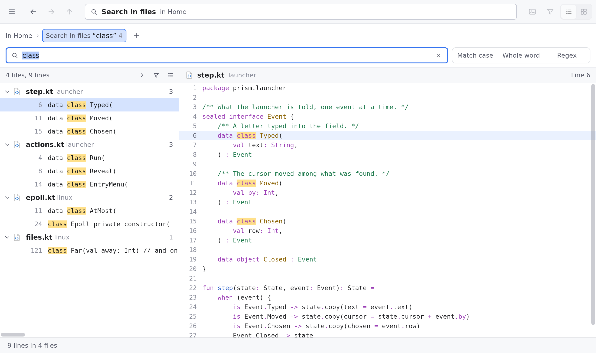
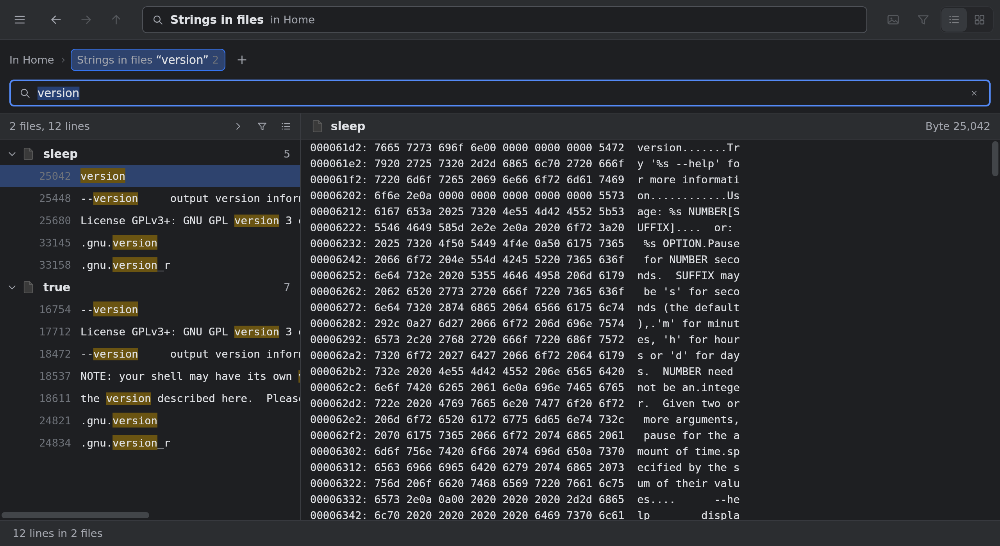
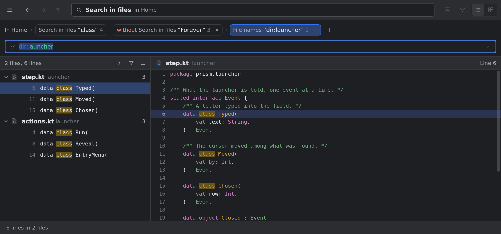
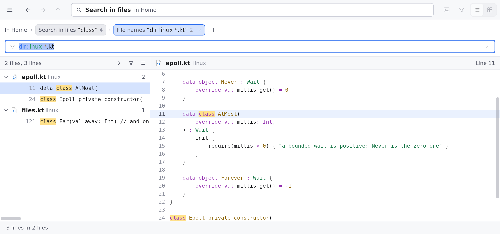
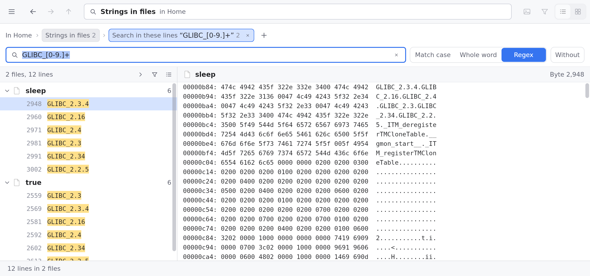
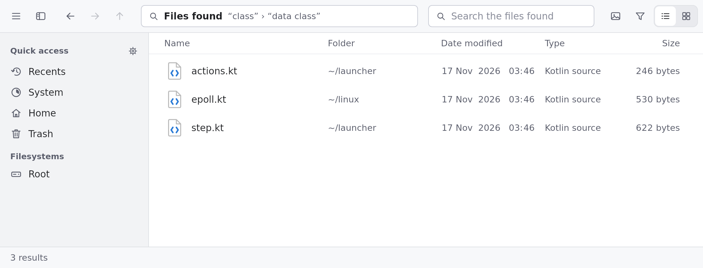
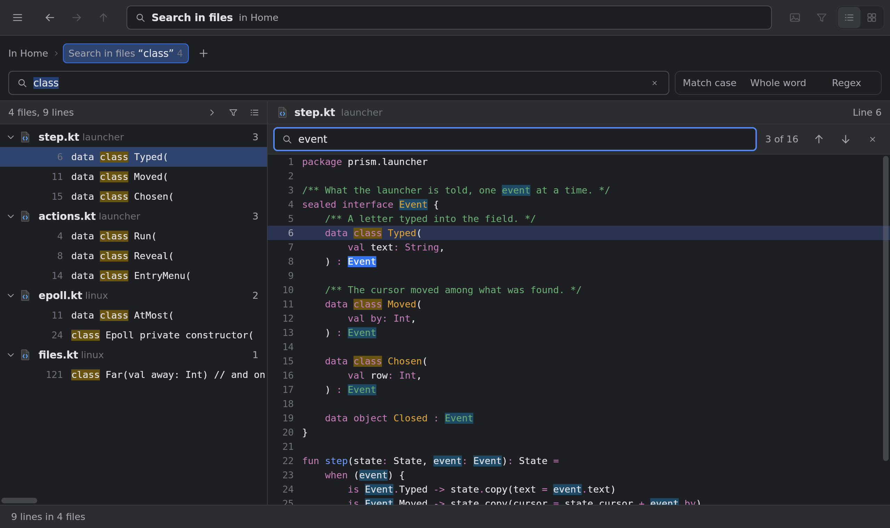

# Text searches: lines found in the files a window shows

A text search looks inside the files a window shows, and shows what it found in their place: the lines found, each
under the file it is in, and beside them the file itself, at the line under the cursor. It is what an editor's
"Find in files" is, in the file manager, over whatever the file manager is showing.

Prism finds nothing itself. A text search is **declared**, as actions and places are (docs/menus.md): what it
declares is a command, which is given the files and prints the lines it finds in them. So the program that searches is
whichever the user has (`rg`, `grep`, `git grep`), and anything else that prints lines of files can be looked through
the same way. Four ship, as declarations in `browser/src/main/resources/prism/browser/actions.json`: "Search in
files…", "Strings in files…", "Search in these lines…" and "List files…".



## One search, followed through

Say the window shows the results of `proj@ *.kt`: every Kotlin file under the `proj` alias. The user presses
Ctrl+Shift+G, types `class`, moves down a few lines and presses Enter. This is the search that ships, written out
with one program (as it ships, it names `grep` as a second way, for a machine without ripgrep):

```json
{
  "id": "text.search",
  "label": "Search in files…",
  "key": "Ctrl+Shift+G",
  "query": "typed",
  "options": {
    "case": { "label": "Match case", "off": ["--ignore-case"] },
    "word": { "label": "Whole word", "on": ["--word-regexp"] },
    "regex": { "label": "Regex", "off": ["--fixed-strings"] }
  },
  "run": ["xargs", "-0", "-r", "rg", "--json", "{options}", "-e", "{query}", "--"],
  "read": "rg-json",
  "previews": [
    { "programs": ["bat|batcat"],
      "run": ["{which:bat|batcat}", "--color=always", "--style=plain", "--paging=never",
              "--theme=ansi", "--tabs=0", "--", "{path}"] }
  ]
}
```

**It is opened.** The key is an event, `BrowserEvent.SearchedText(search)`, and the reducer goes to a new place,
`Location.Text`, as it goes to a folder: what the window showed goes behind it in the history, so Back (or Escape)
returns to it. The place keeps what is looked in, which is what the window showed as the search was opened
(`TextScope`): here, every result of `proj@ *.kt`.

**Typing runs the command.** With `class` typed, the reducer asks for a run: `Effect.FindText(TextRun)`. The session
starts the command a moment later (120 ms), so that the next letter typed takes its place before it starts. Its words
are `run`, filled: `{query}` is what was typed, as one word whatever is in it, and `{options}` is the words of every
option as it is on or off (`--ignore-case --fixed-strings`, with none turned on).

**The files are its standard input.** Each file that was in view is written to the command's standard input, with a
NUL character after it. That is what `xargs -0` reads, and why it is there: it hands the files to `rg` as arguments,
as many at a time as fit. A search's results can be a million files, which no command line holds. In a plain folder,
what is written is the folder's rows, folders among them, and `rg` goes into those itself: so a search is recursive
over what is in view.

**What it prints is read as it prints it.** `read` says how. Each line read is a `FileHit`: the file, the line's
number, its text, and where in the text the match is. The session sends them to the reducer in batches, many times
a second, and the list grows as they come. Nothing waits for the command to end.

**The next letter stops it.** One run is under way at most. A letter typed, or an option turned, asks for another run,
and the one under way is stopped, with everything it started. What it found stays shown until the new run finds
something, or ends having found nothing: the list is not emptied at every letter. Lines a stopped run sends late are
of no run the window knows, and are dropped (a `TextRun` is equal only to itself).

**The file is shown beside the line.** The cursor starts on the first line found. The file it is in is asked for:
`Effect.Preview`. Where the search names a preview command that is installed, its output is shown, coloured as it
printed it; otherwise prism reads the file as plain text. Either way prism scrolls it to the line, and marks what
matched in it, since it knows both from the line found. Moving among the lines of one file asks for nothing more.

**Enter hands over to the editor.** `BrowserEvent.TextOpened` becomes `Effect.Launch`: the user's editor, given the
file and the line. Prism does not edit.

## What is looked in

| opened from | looks in |
|---|---|
| its key, or the menu of the space around the rows | everything the window shows: a folder's rows as they are filtered, a search's results, a place's files |
| the menu of chosen rows | those rows |
| the menu of a folder in the sidebar | that folder |
| beside what a text search found | what that search's last step gave: it is added to it as a step ("Steps", below) |

A text search needs files on disk. It is not offered where there are none: on the entries of an archive, on a
place's own groupings, in an empty folder. Like the user's actions, it is an explorer's to offer, and never a
picker's.

## A search, declared

Text searches are under `"textSearches"` in `$XDG_CONFIG_HOME/prism/preferences.json`. One written there with the id
of one that ships replaces it. Each is read on its own: one written wrong is listed on the preferences' "Actions"
page with why, and the rest are still read.

| field | says |
|---|---|
| `id`, `label` | what it is known by, and what the menu calls it |
| `key` | the chord that opens it on everything shown, until the user binds another (it is on the "Key bindings" page, under "Search") |
| `when` | the conditions an action has (docs/menus.md). Unless `target` is said, it is offered whatever the menu is of |
| `submenu` | the submenu it is offered in |
| `query` | `typed` (unless said) or `narrows`: see below |
| `options` | what can be turned on beside the field, each by a name: its `label`, and the words the command is given when it is `on` and when it is `off` |
| `run`, or `ways` | the command; or several, each with the `programs` it needs, the first that can be run here being used |
| `takes` | what it is given on its standard input: `files` (unless said), or `lines` found already: see "Steps" |
| `read`, `nul`, `positions` | how what it prints is read: see below. A way can say its own `read` and `nul` |
| `preview`, or `previews` | the command whose output is shown beside a line; or several, as `ways` are |
| `open` | what opens a line, in place of the user's editor: `{ "run": […], "terminal": true }` |

### What is typed

A search whose query is **`typed`** gives it to its command, as `{query}` (and as `$query`, in its environment), and
runs the command again whenever it changes. With nothing typed it runs nothing. This is for a program that searches.

A search whose query **`narrows`** runs its command once, as it is opened, with no query. What is typed then narrows
what was printed, inside prism: to the lines that have every word typed in them, without case. This is for a program
that only lists. "Strings in files…" is one:

```json
{
  "id": "text.strings",
  "label": "Strings in files…",
  "when": { "target": "folder", "programs": ["strings", "xargs"] },
  "query": "narrows",
  "run": ["xargs", "-0", "-r", "strings", "--print-file-name", "--radix=d", "--"],
  "read": "lines",
  "positions": "offsets",
  "previews": [
    { "programs": ["xxd"], "run": ["xxd", "-s", "{offset}", "-l", "4096", "{path}"] }
  ]
}
```



### What its command prints

| `read` | each line of output is | printed by |
|---|---|---|
| `lines` (unless said) | `path:12:text`. A number and a space also part them, as in `path:    4096 text` | `grep -n`, `git grep -n`, `strings -f -t d`, compilers |
| `rg-json` | one of ripgrep's `--json` messages | `rg --json` |
| `json` | an object: `path`, and any of `at` (the number), `text`, and `marks` (pairs of where a match starts and ends in the text) | a script of your own |
| `paths` | a file, and no line of it | `rg --files`, `rg -l`, `git ls-files`, `fd` |

A line that is not of its kind is passed over. A relative path is in the folder the command ran in, which is the
folder shown (the home folder, where the window shows none).

**What matched** is said outright by the two JSON forms. In `lines`, it is whatever the program drew differently in
the text: its escape sequences for colour are read out of the line (`browser/ansi.kt`), and the runs they covered are
the marks. So `grep --color=always` is enough for its matches to be highlighted, and the program needs to know
nothing of prism.

**`"nul": true`** reads a NUL character as the end of the path, as `grep -Z` and `rg -0` print it. Without it, the
path ends at the first colon that a number follows, so a file with `:12:` in its name is read wrongly. With it, a
line may have no number at all.

**`positions`** says what the number is. `lines` (unless said) is a line of the file, from 1: the file beside the
list is scrolled to it, and a command names it `{line}`. `offsets` is a byte of the file, from 0, as `strings -t d`
prints: a command names it `{offset}`, and the file is not scrolled by it.

### How it ends

How a command ended is read from what it found and what it wrote to standard error, and not from its status: `grep`
and `rg` end with 1 where they find nothing, and `xargs` with 123 where any command it ran did. So:

- It found nothing, and wrote something to standard error: it failed, and what it wrote is shown where the list
  would be, in letters of one width (a program that points at where a pattern goes wrong points with spaces).
- It found something, and wrote something there too: what it found is shown, and the last line it wrote is in the
  status line (a file it could not read).
- It found 100,000 lines: it is stopped there, and the status line says so.

While it runs, the status line has a spinner, and once it has run for a moment the field has one too, with a square
in it that stops the command.

### The file beside the list

A preview command is run with the file as `{path}`, and what it prints is shown as a terminal would colour it. Its
eight colours and their bright ones are prism's own, for the palette in use, so a program told to use the terminal's
colours (`bat --theme=ansi`) is readable in the light palette and the dark one; the 256 colours and colours said
outright are as they are said.

A preview that names only `{path}` is run once for a file, and prism scrolls it to each line. For the marks to sit
where they should, it must print the file's lines as they are: one line for each, with nothing before the text
(`bat --style=plain`). Tabs are left to prism (`--tabs=0`), which draws them to stops of four.

A preview that names `{line}` or `{offset}` is run for each line found, and shown from its top: a dump of the bytes
about a string, say.

With no preview command, or none that is installed, prism reads the file as text. A file longer than 20,000 lines is
read about the line wanted. A file with a NUL character near its start is said not to be text.

## Steps, one after another

A text search is one or more **steps**. Each is given what the one before it gave, and what the last gives is what the
window lists. Say you want every file that has both `class` and `Forever` in it, on whatever lines:

1. Search for `class`. The list is every file with `class` in it.
2. Press Ctrl+Shift+G again, or the + after the steps, and choose "Search in files…". A second step is added, and
   what is typed is now for it.
3. Type `Forever`. The second step is given the files the first one found, and nothing else. The list is the lines
   with `Forever`, in files that also have `class`.



The steps are over the field, as chips, in the order they run: where it looks, then each step with what is typed for
it and how many files it gave. One of them is lit: the one what is typed is for. A click on a chip makes it that one,
so any step can be typed for again; it and every step after it are then run again, and those before it are left as
they are. Each chip but the first has a cross, which takes the step out.

What goes from a step to the next is files, with the lines found in them (`TextFlow`, in `browser/pipeline.kt`). A
step is one of three kinds, by what it takes of that and what it gives:

| a step that is | is given | gives |
|---|---|---|
| a search that takes **files** (any search, unless it says otherwise) | the files | the lines it finds in them, under their files |
| a search that takes **lines** (`"takes": "lines"`) | the lines | those of them it keeps, each still of its file and at its place |
| a query of **names** (the funnel over the list, or "Filter files by name…" in the + menu) | the files | those whose names, and where they are, the query finds, with their lines |

So which steps can follow which is not a rule that is written anywhere: it is what each takes. `strings` takes files,
so it can follow anything that gives files; it does not take lines, so it is never offered to look through lines. A
search that takes lines is offered only once some step has found lines.

### Turned about: what it does not find

A search after the first has a toggle, **Without**, beside its options. Turned on, the step gives what it was given
and found nothing in: the files it found no line in, with whatever lines they came with; or, of a search that takes
lines, the lines it did not keep. Prism does this, by taking what the command found away from what it was given, so
it is the same for every program.

The first step has no such toggle. What it is given is what the window showed, which may be folders, and which files
are in those only its command knows. To have "every file without X" of a folder, list its files first: "List files…"
(from the folder's menu) and then a search, turned about.

### A search that takes lines

Its command is given the lines, one to a line of its standard input, as text: nothing of which file each is in. It
prints the ones it keeps as `grep -n` prints lines of its input: `N:text`, where `N` is the line's number among those
it was given. That number is how prism knows which line it kept, and so which file it is of and where in it. What it
colours in the text is what matched, as ever. "Search in these lines…" is one, and ships:

```json
{
  "id": "text.lines",
  "label": "Search in these lines…",
  "takes": "lines",
  "run": ["rg", "--json", "--line-number", "{options}", "-e", "{query}", "-"],
  "read": "rg-json"
}
```

The lines it keeps are still the lines of whatever found them in files. That search says what their numbers are, how
their file is shown beside them, and what opens them: after `strings`, a line kept by `rg` is still at its byte, and
the file beside it is still the bytes about it.

### A search that gives files and no lines

`"read": "paths"` reads each line a command prints as a file, and no line of it: what `rg --files`, `rg -l`,
`git ls-files` and `fd` print. Such a step gives the files it names, with whatever lines they came with. First, it is
a list of files, which what is typed narrows by where each is. "List files…" is one, and ships.

### A query of names

What is typed for it is a query in the language a search of the index is typed in (docs/search.md), run over the
files it is given, by their names and where they are:

| typed | gives the files |
|---|---|
| `step` | with `step` in their names |
| `*.kt$` | whose names end in `.kt` |
| `dir:linux` | under a folder called `linux` |
| `ext:md` | of that extension |
| `proj@ -test` | that the alias `proj` finds, without `test` in their names |



It runs no command. Which files it finds is worked out off the window's thread, in an index made of the files it is
given and no others (`Index.given`, as a place is searched).

### How they run

One step is under way at a time. A step must have ended before the next is given what it found, so only the last
step's lines are shown as they come; while an earlier one runs, its chip has a spinner, and the list shows what it
showed. A step that fails says so where the list would be, and no step after it is run. A step with nothing typed for
it (just added) gives what it was given, so adding a step does not empty the list.

A step that stopped at 100,000 lines gave the next the files it had found by then, which may not be all of them: its
chip's count has a + after it.

### Chains that work, and are tested

Each of these is run in `TextTest`, with the machine's own programs:

| wanted | steps |
|---|---|
| the files with A and B, on any lines | Search in files `A` › Search in files `B` |
| the files with A and no B | Search in files `A` › Search in files `B`, without |
| A, in the files under one folder, that also have B | Search in files `A` › names `dir:launcher` › Search in files `B` |
| the strings of a binary that look like version numbers | Strings in files › Search in these lines `[0-9]+\.[0-9]+` (Regex) |
| the TODOs that name nobody | Search in files `TODO` › Search in these lines `TODO\(\w+\)` (Regex), without |
| the files with no licence | List files › Search in files `licensed under`, without |
| what the binaries that use a library say when they fail | Strings in files, narrowed to `libssl` › Strings in files, narrowed to `failed` |
| the files found, zipped (or anything else done to files) | any steps › "Show these files as a listing" › choose them, and the action |



### The files found, as a listing

The last button over the list shows the files it lists as a listing of files: all together, each with its folder,
size and date, as a search's results are shown. There they are files as anywhere: chosen, copied, dragged, moved to
the trash, and given to any action. Back is the search again, as it was left.



It is a place (docs/menus.md) that no command lists: it holds what was found when it was made, and reading it again
changes nothing. Searching in it (Ctrl+Shift+F) finds among those files, and a text search opened on it looks in
them.

## Looking in the file shown

Ctrl+F looks in the file beside the list, as it does in any text, and is no part of the search: it changes nothing
of what was found. Every place what is typed is at, without case, is marked in the file, and the one gone to is
marked in the accent and brought into sight. It starts at the first place at or after the line the file is shown at.

| keys | what |
|---|---|
| Enter, or the button with the arrow down | the next place; past the last, the first |
| Shift+Enter, or the button with the arrow up | the one before |
| Escape, or the cross | puts it away |



What it looks in is what is shown, so in a file too long to be read whole it looks in the part that was read.

## The editor

A line is opened by the first of these there is:

1. the search's own `open`;
2. `"editor"` in the preferences: `{ "run": ["code", "--goto", "{path}:{line}"] }`, with `"terminal": true` for one
   that runs in a terminal;
3. the editor the environment names, `VISUAL` and then `EDITOR`, in the terminal chosen in the preferences. It is
   given the line as `+12 file`, which most take. Those prism knows to take it otherwise, or to have a window of their
   own, are given it their way (`Editor.KNOWN`: VS Code and its kin, Sublime Text, Zed, Helix, Kate, the JetBrains
   editors, gedit and its kin);
4. the file's own application, which is not told the line.

The daemon's environment is the one it was started with. A session's service may have no `EDITOR` in it, where a
terminal's shell does: then set `"editor"`.

The preferences' "Actions" page says which editor is in use.

## Keys, and the menus

| keys | where | what |
|---|---|---|
| Up, Down, Page Up, Page Down | the field, the list | the cursor, among the files and their lines |
| Home, End | the list | the first row, the last |
| Left, Right | the list | a file's lines put away under it, or shown again |
| Enter | the field, the list | the row under the cursor opened in the editor |
| a search's own key (Ctrl+Shift+G) | anywhere | that search added as a step, looking in what was found; what is typed is then for it |
| Ctrl+L | anywhere | the keyboard to the field |
| Ctrl+F | anywhere | what looks in the file shown: opened, or given the keyboard again |
| F5 | anywhere | every step run again |
| Escape, Alt+Left | anywhere | back to what the window showed; Alt+Right comes back to what was found, which is kept |

A click puts the cursor on a row. A double click opens a line, and folds a file.

Over the list are how many files and lines it lists, and three buttons: one folds every file or unfolds them, one
adds a step that narrows the files by a query of their names, and one shows the files as a listing.

The list has three tenths of the window, until the line between it and the file is dragged. Dragged as far as it
goes, either side keeps 200 pixels. Each side scrolls down and across where what it shows is longer or wider than
its room: across by its bar, by the wheel with Shift held, or by a touchpad. A file's own row stays where it is as
its lines are scrolled across, so that it is always said whose they are.

**A line's menu** has "Open in editor", "Open containing folder", "Copy line" and "Copy path", and the user's
actions that say they are for this search's lines:

```json
{ "id": "blame", "label": "Blame this line",
  "when": { "in": ["text.search"] },
  "run": ["git", "blame", "-L", "{line},{line}", "{path}"],
  "how": { "terminal": true } }
```

Such an action can name `{line}` (or `{offset}`), `{text}` and `{query}` beside the file. A line is not its file, so
an action that is for files in general is not offered for one.

**A file's menu** has those, "Open with…" and "Properties", and every action of the user's that is for a file: it is
a file on disk, wherever it is shown.

**A line of the file beside the list** has "Edit this line", which opens the editor at that line, whether or not it
was found.

## Where it is

| | |
|---|---|
| `preferences/actions.kt` | the shapes of the JSON: `TextSearchSpec`, `OptionSpec`, `OpenSpec` |
| `browser/text.kt` | what a search is (`TextSearch`), what one found (`Hit`, `Hits`), what reads a command's output (`HitReader`), what the list shows (`TextRows`), and the editor |
| `browser/ansi.kt` | a terminal's colours read out of text |
| `browser/actions.kt` | the searches read with the actions, and checked |
| `browser/pipeline.kt` | a search as steps: the three kinds of step, what goes from one to the next, and what each makes of what it found |
| `browser/texting.kt` | the reducer's part: which step runs next and what a change runs again; opening, typing, moving, folding, opening a line |
| `browser/textsource.kt` | the command run, on files or on lines, and what it did not find where that is wanted; a file read to be shown |
| `browser/session.kt` | one run at a time, its lines sent in batches, stopped by the next |
| `browser/textview.kt` | the steps, the field, the list and the file, drawn; and what looks in the file shown |
| `browser/menus.kt` | the searches in the context menus, and the menus of a line and of a file |

## Not built yet

- **Lines piped in from a shell**, as `prism dmenu` takes lines: `rg --vimgrep TODO | prism lines`, for a build's
  errors to be gone through with the file beside each. The reader and the view are there; what is not is the
  command, and the lines sent to the prism that is running.
- **The files in a steady order.** They are listed as the command finds them, which for ripgrep is whichever of its
  threads is first. `--sort path` in the command orders them, at the cost of its threads.
- **Highlighting without a program.** With no `bat`, the file beside the list is plain.
- **An editor chosen in the preferences window.** It is written in the file, and shown on the "Actions" page.
- **What was typed last, the options, and the steps, kept** from one opening of a search to the next: a chain
  used often has to be made again each time.
- **A command of its own for when only files are wanted.** A step that is not the last is run as it would be were it
  the last, lines and all, and stops at 100,000 of them; `rg -l` would be cheaper and would not stop short.
- **Steps side by side** (the files that have A *or* B). One pattern with both does it for a program that has
  alternation; nothing does it across programs.
- **Replacing.** Not planned: prism finds, and hands over to an editor.
