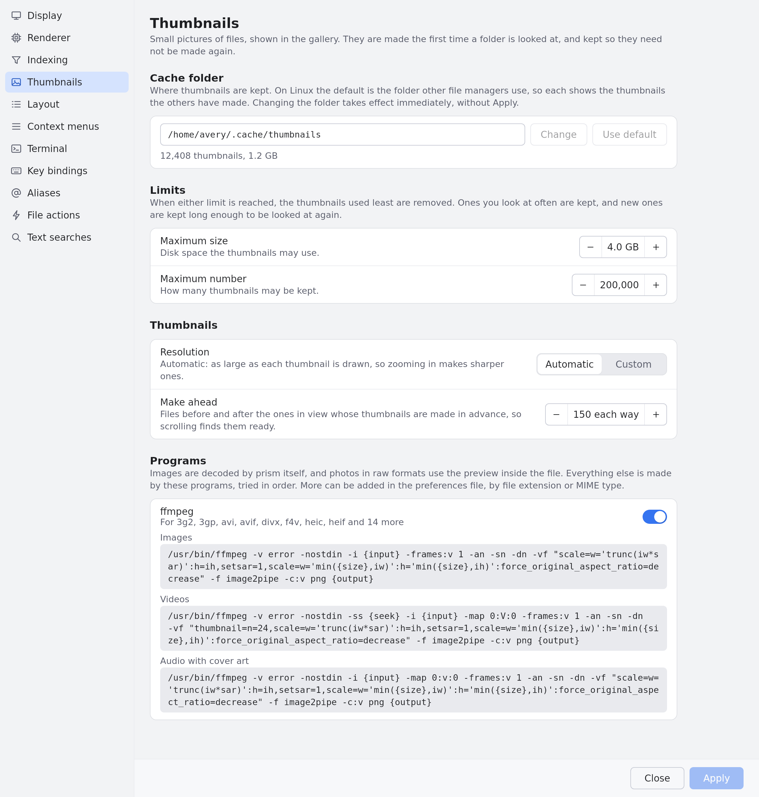
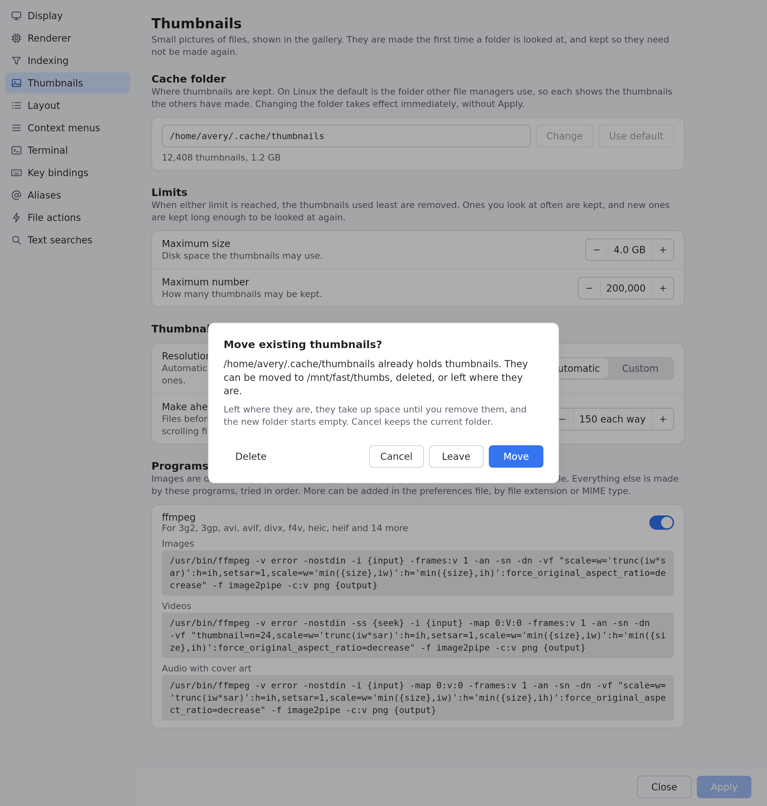

# Thumbnails

The gallery draws a file by a small picture of it: a **thumbnail**. This document says where a file's picture comes
from, what makes one, where thumbnails are kept and how prism knows one is still current, which are made first, how
many are kept, and what can be set. The code is the `thumbnails` module, which draws nothing itself; the browser gives
it what decodes pictures (Skia) and asks it for each tile's picture.

## An example, first

Say `~/Videos` holds two thousand films and photographs, and is opened as a gallery for the first time.

1. Forty tiles are in sight. Each asks for its file's picture (`ThumbnailService.find`).
2. `holiday.png` is 800 by 600. It is small, so it is decoded as it is, each time it is shown: no thumbnail is kept.
3. `IMG_2041.jpg` is 24 million pixels. A thumbnail of it is looked for in the cache and not found, so Skia decodes
   it once, scales it to 256 pixels, and the thumbnail is written to `~/.cache/thumbnails/large/`.
4. `DSC_0007.NEF` is a raw photograph. Skia does not read it, but the camera put a JPEG preview inside the file:
   that is read out, scaled, and written the same way. Nothing raw is developed.
5. `Lisbon.mkv` is a film. ffmpeg is run on it, in a process of its own, for a frame a tenth of the way in.
6. `broken.mkv` is damaged. ffmpeg says so, and a record of that is written to `~/.cache/thumbnails/fail/prism-1/`.
   The file shows its icon, and is not tried again until it changes.
7. Once the forty have their pictures, the 150 files after them and the 150 before are made too, the nearest first,
   so that scrolling finds them ready. The other 1,660 are not made until they are scrolled near.
8. The window is closed halfway: whatever was waiting is not begun, and the ffmpeg that was running is stopped.

Opened again tomorrow, every one of these is one small file read.

## Where a picture comes from

`ThumbnailService.find` answers one of three things for a file:

| answer | when | what the window decodes |
|---|---|---|
| the file itself | an image Skia reads of two million pixels or fewer; or any such image drawn larger than 1024 pixels | the file |
| a thumbnail | everything else that has one, or can have one made | the thumbnail's PNG |
| nothing | nothing makes a picture of it, or making one failed | nothing: the file's icon is drawn |

Skia's decoders are built into it and are the same on every platform: PNG, JPEG, WebP, GIF, BMP, ICO and WBMP. It
uses none of the system's codecs. Whatever it does not read is for the other makers below.

## What makes a thumbnail

Each way is tried in turn until one gives a picture (`Making.makersFor`):

1. **The file decoded by Skia**, where it is of a format Skia reads and has no more than 64 million pixels. A larger
   one would take too much memory while it is decoded, in prism's own process.
2. **A picture the file carries** (`Embedded`), where it is at least as large as what is wanted. A raw photograph's
   preview and a JPEG's Exif thumbnail are found by reading the file's TIFF directories, in Kotlin: Canon's CR2,
   Nikon's NEF, Sony's ARW, Adobe's DNG, Pentax's PEF, Olympus' ORF, Panasonic's RW2 and Fuji's RAF. Canon's CR3 is
   not read.
3. **Each program that is for the file**: the user's own first, then ffmpeg.
4. **The system's own maker**, where there is one: Quick Look, on a Mac.
5. **The picture the file carries, again**, however small it is: a small picture is better than none.

So an image Skia fails on goes on to ffmpeg, and so does a raw file with no preview. That a file has no thumbnail is
remembered only where a program was run on it and failed. Where nothing was run (ffmpeg is not installed, and nothing
else is for the file), nothing is remembered, since what would make its picture may yet be installed.

### ffmpeg

ffmpeg is used wherever it is installed, on every platform: it is found on the session's `PATH` as prism starts.
Without it, films have no thumbnails, and images are still decoded by Skia and from the previews they carry.

It is the `ffmpeg` program run on a file, a process each time, and not its libraries called from the JVM. A fault in
native code called from Java ends the whole JVM, so a damaged file could take prism down with it; in a process of its
own it ends only that process. A process can also be stopped when it takes too long (twenty seconds), prints too much,
or is no longer wanted. And the command line is the same across versions of ffmpeg, as its libraries' layouts are not.

What it is for is found out: `ffmpeg -formats` is run once, and the formats it lists as read are matched against what
prism knows of each (`Ffmpeg.FORMATS`: its extensions, its types, and whether it is a picture, a film or sound). An
ffmpeg built without SVG is not asked for SVGs. The kind decides the command:

- **a picture** is decoded and scaled;
- **a film** is asked how long it is, and a frame taken a tenth of the way in (and no further than five minutes), the
  most telling of the two dozen frames from there; one that cannot be sought in has its first frames looked at;
- **sound** has the cover it carries, where it carries one.

The picture is scaled down to fit and never up, in the shape the film is shown in (pixels that are not square are made
so), and printed as a PNG.

### Other programs

A program is a command line and the files it is for, by extension and by MIME type, in `preferences.json`:

```json
"thumbnailing": {
  "thumbnailers": [
    { "id": "pdf", "name": "PDF pages",
      "command": ["pdftoppm", "-png", "-singlefile", "-scale-to", "{size}", "{input}"],
      "extensions": ["pdf"], "types": ["application/pdf"] },
    { "id": "epub", "command": ["gnome-epub-thumbnailer", "-s", "{size}", "{uri}", "{output}"],
      "extensions": ["epub"] }
  ],
  "off": ["ffmpeg"]
}
```

| in a command | is |
|---|---|
| `{input}` | the file's path |
| `{uri}` | the file's address, `file:///…`, for a program that takes one |
| `{size}` | how many pixels across the picture is to be, at most |
| `{output}` | a file for the program to write the picture to; a command without it prints the picture |

Whatever picture comes of it, in any format Skia reads, is made a PNG no larger than was asked: a program that prints
a JPEG, or writes a larger picture than it was told to, is as good. A command that names no file, has a placeholder
there is none of, or names no extensions and no types, is not a program; the Thumbnails page says so, and the rest
are read. `off` lists the ids of programs turned off, `ffmpeg` among them. ffmpeg's command is prism's own: it is
shown, and cannot be changed. There is no editor for these in the preferences window yet.

## Where thumbnails are kept, and how one is known to be current

On Linux they are kept as freedesktop.org's Thumbnail Managing Standard has it, in `$XDG_CACHE_HOME/thumbnails`
(`~/.cache/thumbnails`), which Nautilus, Thunar and Dolphin write to as well: a thumbnail one of them made is shown
by prism, and one prism made is shown by them. On a Mac and on Windows nothing is shared, and they are kept in the
same form in prism's own cache.

Take `~/Videos/Lisbon, day one.mkv`. Its thumbnail is named by its address alone: the MD5 of
`file:///home/u/Videos/Lisbon,%20day%20one.mkv` (written exactly as GLib writes one), and `.png`, in a folder for each
size: `normal` (128 pixels), `large` (256), `x-large` (512) and `xx-large` (1024).

A thumbnail says, in its PNG's text, which file it is of (`Thumb::URI`), when that file was last changed
(`Thumb::MTime`, in seconds) and how large it was (`Thumb::Size`). It is the file's picture only while all three are
the file's. So what says whether a thumbnail is current is in the thumbnail itself, on every platform, and there is no
list of them to fall out of step with the files. The file's contents are never hashed: that would mean reading a film
of several gigabytes to learn whether its thumbnail can be used.

That making a thumbnail failed is kept the same way: a PNG of one transparent pixel, saying which file and as of
when, in `fail/prism-1/`.

Thumbnails are written beside where they go and renamed into place, so no reader sees half of one, and are readable
by the user alone.

## What is made first

Every window asks the one service, so a picture two windows show is made once.

- **What is shown comes first.** A tile in sight waits ahead of anything that is only near.
- **Then what is near**: 150 files after what is in sight and 150 before (the number can be set), the nearest first,
  turn about. A gallery jumped far down a folder of a hundred thousand asks for those around where it landed, and no
  longer for those where it was. A whole folder is never made because it was opened.
- **Nothing else.** Nothing is made in the background of files no window is near.
- **What is no longer wanted stops.** A tile scrolled away stops waiting. A window that goes to another folder, or is
  closed, says so, and what was waiting for it is not begun; what had begun is stopped, the program with it. What
  two windows ask for stops once neither wants it.

Looking a thumbnail up waits for nothing. Only making one takes one of the few places there are (two to four, by the
machine's processors), and what is near never takes the last of them, so there is always one for a tile in sight.

## How many are kept

The cache has a budget, in bytes and in files (four gigabytes and two hundred thousand, unless set otherwise). Every
thumbnail in the folder counts, **whoever made it**: those there as prism starts, those it makes, and those another
program makes while it runs. Those last are heard of from the daemon's own feed of changes (`Listening`, which sees
every change on the machine, in folders the index leaves out too), or, where there is no feed, from the same watcher
a window uses for the folder it shows. One prism did not make is taken to have been made when its file was written.

When the cache is over either limit, it is cut to nine tenths of it. Which thumbnails go is decided as prism decides
which folders gone to are worth remembering (`prism.shared.Uses`), by how much each is used and how lately:

- A thumbnail shown on more than one occasion is **established**. The established are kept by how much they are used,
  in all the room there is but a fifth. What a thumbnail's uses weigh halves every sixty days without use, so one
  looked at every week all spring is still kept in the autumn.
- Everything else is **on trial**: a thumbnail shown once so far. The most lately used of those are kept, in the
  fifth that is theirs and whatever the established leave free.

So five thousand new thumbnails from one folder scrolled through cannot push out the pictures looked at every week;
and a new thumbnail always has a place, and time to be shown again and become established. With the default budget
the trial's fifth is thirty-six thousand thumbnails.

An occasion is not a showing: a tile scrolled past ten times in a minute was looked at once. A showing within an hour
of the last adds nothing.

Size counts too. A thumbnail more than twice as large as one of its size should be is weighed as that much less used
and that much older, so of two that are otherwise alike the heavy one goes first.

What prism knows of use is kept in `thumbnails.used`, in its state folder, and is nothing but that: whether a
thumbnail is there, and whether it is current, is only ever the cache's to say.

## What can be set



The preferences have a Thumbnails page, after Indexing:

| setting | what it does |
|---|---|
| Cache folder | where thumbnails are kept |
| Maximum size, Maximum number | the budget |
| Resolution | Automatic: each thumbnail is made at the size it is drawn. Custom: every one at one size |
| Make ahead | how many files either side of what is in sight are made in advance; Off for none |
| Programs | each program, what it is for and what it runs, with a switch |

All but the folder are applied with Apply, as every page's settings are.

### Changing the folder



The folder is changed by its own button, at once, since what becomes of the thumbnails in the old folder has to be
said as it is changed. Where the old folder holds any, prism asks: move them, delete them, or leave them. Whichever
is chosen, the new folder is written to the preferences then, and is where thumbnails are kept from that moment;
anything else changed in the window still waits for Apply.

Moving shows how far it has got, and can be stopped. It moves one thumbnail at a time, each whole, so stopping it
leaves two good folders: what was moved is in the new one and is used from there, and the rest is where it was, as if
it had been left. A thumbnail moved is known as it was: what is remembered of its use goes with it.

Only thumbnails are ever moved or deleted: PNGs named as thumbnails are, in the folders thumbnails are kept in. A
folder that holds other things loses none of them.

## Not yet

- The program is not confined beyond being a process of its own with a time limit: no sandbox, and no limit on its
  memory.
- Files on network shares are treated as any other. Nothing is ever written beside the files themselves.
- Files a cloud service has not downloaded are not told apart: asking for their thumbnail reads them.
- Thumbnails whose files are gone are not looked for; they go when they are the least used.
- Canon's CR3 has no reader for its preview.
- An editor for programs' commands in the preferences window.
- Windows has no system maker of its own; with ffmpeg installed it has everything else.
